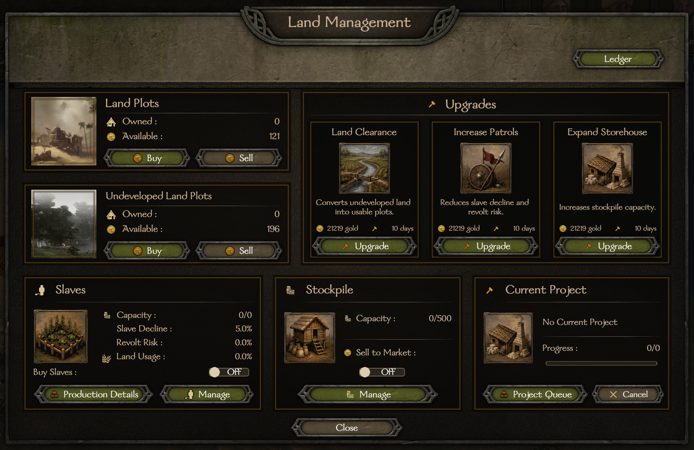

# AgricultureEstate

Buy land in Bannerlord villages and build an estate that earns rent or produces goods with prisoner labor. Manage plots, workers, storage, and upgrades from the village's **Land Management** menu.

## Installation

1. Download the mod ZIP for your Bannerlord version from [Releases](https://github.com/DasNeo/AgricultureEstateUpdated/releases). Check the release notes for the target game version and known limitations. Preview releases are intended for testing.
2. Install **Bannerlord.Harmony** and **Mod Configuration Menu (MCM v5)**, including their required dependencies, separately.
3. Extract the mod ZIP into your Bannerlord game folder. The resulting folder should be `Mount & Blade II Bannerlord/Modules/AgricultureEstate/`, with `SubModule.xml` directly inside it.
4. Enable AgricultureEstate and its dependencies in the launcher. Load Harmony and MCM before AgricultureEstate, and place AgricultureEstate after the base game modules.
5. Start a single-player campaign or load your campaign, then visit a village and select **Land Management**.

Keep a backup of your campaign save before updating the mod or changing your mod list. Check the release notes for compatibility information.

## Getting started

1. **Buy developed plots** to start earning rent. Undeveloped plots must be cleared before they can earn rent or support workers.
2. **Choose rent or production.** Leave land unused for rent, or transfer eligible prisoners to produce the village's goods. Each developed plot supports up to **10 prisoners**.
3. **Collect or sell your goods.** Withdraw goods from the estate stockpile to sell yourself, or enable automatic sales to the village market.
4. **Improve your estate.** Clear more land, expand storage, and increase patrols as your estate grows.

Open the estate ledger to review your estates and their income. Hover over controls for costs, output estimates, and other details. Several controls support Shift-click shortcuts described in their tooltips.

## Rent and production

### Why does rent differ between villages?

Rent depends on the village's accumulated trade-tax revenue, your developed plots, and how much land is unused by prisoner labor. It is not a fixed payment per plot. Village trade activity changes that revenue over time, so a high-paying estate may not keep paying the same amount every day.

With the default rent setting, 10 plots and no workers earn 10% of the village's accumulated trade-tax revenue. Filling half the estate's worker capacity halves the rent; filling it completely reduces rent to zero. Looted villages pay no rent.

Use the estimated output tooltip to compare estates, but treat it as an estimate. Total estate income can include both land rent and goods sales.

### How does prisoner labor work?

Bandit prisoners can be transferred to an estate as workers. The **Forced Labor** Steward perk also allows manual transfers of non-bandit prisoners. Enable **Allow all prisoners as slaves** in the mod settings to use non-bandit prisoners without that perk. Hero prisoners are always excluded.

Workers produce goods associated with the village. Production pauses while the village is being raided or is looted. Goods are stored at the estate unless automatic selling is enabled; production stops when storage is over capacity. Village sale prices can be lower than prices you find in towns.

Workers can escape or revolt. Monitor the escape and revolt figures in Land Management, improve patrols, and consider the village militia when deciding how many prisoners to keep.

### How does automatic buying work?

Enable **Buy Slaves** for the estate. Purchases require an eligible visiting party carrying suitable prisoners, free worker capacity, and enough gold in your character's purse. This is not a daily purchase from an unlimited market.

By default, automatic purchases accept bandit prisoners. Enable **Allow all prisoners as slaves** to include other non-hero prisoners; automatic buying currently does not use the Forced Labor perk to expand eligibility.

Estates can also buy eligible prisoners when a party sells them at the village's bound town or castle. Only prisoners offered in that sale are considered, and purchases still require free capacity and enough gold. You can also transfer eligible prisoners manually.

## Estate upgrades

| Project | Effect |
| --- | --- |
| Land Clearance | Converts one owned undeveloped plot into a developed plot. |
| Expand Storehouse | Adds 500 storage capacity. |
| Increase Patrols | Reduces escape and revolt risk; up to eight upgrades. |

Projects cost gold and take time. Costs and duration can be changed in the mod settings. Cancelling a project does not refund its cost.

## Skills and perks

AgricultureEstate adds the following estate benefits to your character's perks. These effects are also described in the in-game perk tooltips.

| Skill | Perk | Estate benefit |
| --- | --- | --- |
| Riding | Mounted Patrols | Reduces prisoner escape chance by 20%. |
| Riding | Breeder | Increases prisoner production by 10% in villages whose primary production is horses. |
| Steward | Forced Labor | Allows manual transfers of non-bandit prisoners for estate labor. Heroes remain excluded; automatic buying still requires the setting described above. |
| Steward | Contractors | Reduces estate project costs by 15%. |
| Roguery | Manhunter | Reduces automatic prisoner purchase costs by 20%. |
| Trade | Insurance Plans | Compensates for plots lost during war: currently 80% of their configured sale value. |
| Trade | Rapid Development | Provides the same wartime land compensation as Insurance Plans. Having both perks does not increase the refund. |
| Trade | Tradeyard Foreman | Increases prisoner production by 20% in villages whose primary production is clay, iron, cotton, or silver. |
| Trade | Granary Accountant | Increases prisoner production by 20% in villages whose primary production is grain, olives, fish, or dates. |
| Engineering | Foreman | Adds 30 hearths to the village when a Land Clearance project finishes. |

## Settings

Open **Mod Options** and select **Agriculture Estate** through MCM to adjust:

- Developed and undeveloped plot purchase and sale prices.
- Project cost and duration.
- Rent and prisoner production multipliers.
- Prisoner decline rate; set its modifier to **0** to disable decline.
- Whether non-bandit prisoners can be used without Forced Labor.
- Available developed and undeveloped plots per village. Changes adjust availability in existing estates without removing owned land.
- Whether land is lost when its owning faction is at war with yours. This is **enabled by default**.

## Troubleshooting and reports

- **Land Management is missing:** check that AgricultureEstate is enabled, its dependencies are installed, and you are visiting a village in a single-player campaign.
- **No goods are being produced:** check that you have developed plots and workers, storage is not over capacity, and the village is not being raided or looted.
- **Rent has fallen:** village trade revenue fluctuates, and adding workers reduces the land available for rent.
- **Land was lost during war:** check the setting that removes plots in hostile territory.

Report problems through [GitHub Issues](https://github.com/DasNeo/AgricultureEstateUpdated/issues). Include your Bannerlord version, AgricultureEstate release, other enabled mods, and steps to reproduce the issue. For crashes, include the crash report or relevant log.

## For contributors

Build instructions and the release workflow are documented in [Building and releasing](docs/BUILDING.md).
