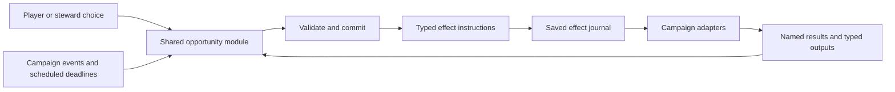

# Estate opportunity framework

Status: Collaborative draft. Open questions are not implementation requirements.

## Design overview

Confirmed direction: a player-only estate business with market-driven merchant orders and regional food, tools, and transport shortages. Players can intervene personally or delegate through skilled hired stewards and companion assignments. Stewards follow explicit policies, budgets, and spending limits. Physical shipment parties connect estate decisions to campaign travel, escort, combat, and recovery.

A new estate-business management screen replaces the ledger. Routine activity appears there; urgent threats and newly blocked automation prompt the player. Regional shortages follow authored stages and branches, with visible stakes and time to respond. Merchant commitments build or damage a shared business reputation.

Detailed rules below are the current design. The decision log preserves the discussion history; later decisions explicitly supersede earlier choices where noted. Remaining work includes interface layout, numeric balance, unresolved lifecycle details, and implementation architecture. No gameplay implementation is authorized by this document alone.

## Purpose

Make estate ownership more interactive by presenting opportunities that invite player decisions and actions between income payouts.

The existing mod provides land purchases, production, stockpiles, automatic market sales, labor, patrol upgrades, construction queues, revolts, and wartime land loss. Build on those systems where useful, but remove wartime estate loss in the target design as specified below.

## Confirmed scope

- Design an opportunity framework together before implementing it.
- Record decisions and unresolved questions in this document.
- Estates can only ever be player-owned. The framework must not introduce AI-owned estates, rival estate owners, or transfers of an estate to an NPC owner. Hired stewards manage the player's property; they do not own it. Village and town ownership remains part of the surrounding campaign world.
- War no longer removes estates or their land. This supersedes the earlier wartime seizure, complete-land-loss suspension, evacuation, and confiscation design. The existing DestroyPlotsOnWar behavior and its configuration must be retired or made inapplicable in the implementation; a retained default must not continue deleting estates. War can still affect access, buyers, routes, raids, and shortages.
- No local-worker system: no local-worker count, recruitment, wages, or separate worker production model. The earlier approval of a recruitable local-worker count has been withdrawn. Prisoner labor remains unchanged by this reversal; hired stewards and staged transport/defense troops are distinct systems and remain in scope.
- The player's estates draw hired transport from shared nearby hiring hubs. Ordinary merchants, caravans, and campaign conditions can contribute to outside transport demand without requiring AI-owned estates.

## Proposed design principles — awaiting agreement

- Present a concrete situation, understandable choices, and visible stakes.
- Let estate activity connect to the wider campaign where it suits the opportunity.
- Keep the attention required manageable as the player acquires more estates.
- Make outcomes reflect player choices and relevant estate conditions.
- Preserve ordinary estate operation between opportunities.

## First decisions

| Question | Decision |
| --- | --- |
| Main activity: management decisions, campaign actions, or a mixture? | Confirmed: mix estate decisions with campaign activities. |
| Entry point: optional offers, unfolding situations, or both? | Confirmed: both optional offers and unfolding situations. |
| Attention budget: portfolio-wide, per estate, or frequent with delegation? | User selected per-estate generation and frequent opportunities with delegation. Working interpretation: individual estates generate opportunities, and delegation supports larger portfolios. Exact frequency and limits remain open. |

## Opportunity types

- **Optional offer:** the player may choose to take on a new commitment. Merchant offers have visible response windows. Declining or allowing an unaccepted offer to expire incurs no commitment penalty.
- **Unfolding situation:** something is happening at an estate, and the player can respond. Ignoring it produces a visible default outcome. Specific situations can escalate; serious losses require clear advance warning.

Both types may involve estate management decisions and campaign activities.

Unaccepted merchant offers retain their quoted terms until the response window ends despite market changes. Recheck buyer funds at acceptance; an unaccepted quote does not reserve funds. Explicit bargaining can still negotiate revised terms before acceptance. If the affordability recheck fails, explain the shortfall and offer a smaller quantity under revised terms, or allow the player to decline without penalty. Revised terms require agreement rather than silently reducing the order.

The player can negotiate and choose opportunity responses remotely. Personal inventory transfers, personal deliveries, troop reassignment, and initial steward hiring require presence. Authorized merchant collections and hired shipment handovers operate without player attendance. Remote decisions do not imply remotely fighting a campaign battle.

Campaign time pauses while the player reviews the estate-business screen or negotiates and makes decisions. Travel, production, and assignments advance through ordinary campaign time after closing; opening or refreshing a paused screen must not advance simulation.

## Delegation and consequences

| Question | Decision |
| --- | --- |
| Who handles delegated opportunities, and what resources does delegation require? | Confirmed: hired stewards handle routine matters; assigned companions take special assignments. Resource requirements remain open. |
| How do delegated outcomes compare with personal intervention? | Confirmed: outcomes depend on the delegate's skills and resources, using weighted random outcomes with multiple degrees of success. Before committing, the player sees a qualitative forecast with reasons: favorable, uncertain, or risky. Exact weights remain open. |
| What happens when an unfolding situation is ignored? | Confirmed: a visible default outcome occurs, with clear warning before serious losses. Specific situations can escalate into further situations. |

Delegation distinguishes routine estate work from special assignments. Ordinary companion assignments make the companion unavailable for a set duration, without simulated travel. Physical shipment leadership is an explicit exception: the companion stays with the shipment until arrival or defeat. Stewards automatically handle routine opportunities within player-set policies and spending limits, using an estate budget and stockpile funded by the player. Players hire stewards from generated candidates with different skills and wages. Which opportunities qualify for each delegation route remains undecided.

Escalation is specific to the situation rather than a universal response to ignoring opportunities. It follows authored stages with branches based on estate conditions and earlier choices. The number of stages, timing, and opportunities to intervene remain undecided.

## Forecasts, assignments, and escalation

| Question | Decision |
| --- | --- |
| How much information about delegated outcomes is shown before committing? | Confirmed: qualitative forecast with reasons, using favorable, uncertain, or risky. |
| Does a companion assignment require travel and remove the companion from the party temporarily? | Confirmed: ordinary assignments use a fixed duration without simulated travel. Shipment leadership is an exception, lasting until arrival or defeat. |
| Are escalation chains predefined, condition-dependent, or a mixture? | Confirmed: authored stages with branches based on estate conditions and earlier choices. |

Forecast example (illustrative only): "Favorable: this companion has strong Steward skill, and the estate has the required supplies." The skills and resources relevant to each opportunity remain to be defined. Forecasts must reflect the conditions used to resolve the assignment; exact probabilities are not part of the selected presentation.

In detail views, show the main favorable and unfavorable forecast factors. Provide an expandable breakdown of costs, timing, and competing commitments. Distinguish estimates from locked terms and actual delivered quantities; an estimate is not a guaranteed result.

Negotiation and assignment resolution use weighted random outcomes with multiple degrees of success. Skill, resources, and relevant conditions influence the weights. This does not replace physical shipment travel or combat with an abstract success roll. The degrees, their consequences, when a result is committed, and how changing conditions update a forecast remain open.

Hired stewards improve relevant skills through relevant work, within a cap. Experience awards, cap values, wage progression, and whether failed tasks grant experience remain open. Experience should be tied to actual completed work or resolved attempts rather than repeated status checks.

Steward wages stay at the agreed amount until a clearly signaled renegotiation at skill milestones. Skill gains do not silently raise wages. If a requested increase is declined, keep the current wage but pause skill growth until an agreement is reached. Declining a raise does not itself suspend existing management or cause resignation. Milestones, negotiation timing, and agreement terms remain open.

Recruit generated steward candidates while visiting the estate or a nearby town; appointment starts there. Initial hiring remains in person. After hiring, steward transfers can be ordered remotely through the business screen, with a quoted transfer delay and warnings about order-capacity changes. Source and destination service during transfer, wage treatment, and cancellation remain open. Candidate refresh, the definition of a nearby town, and appointment prerequisites also remain open.

Stewards initially manage one estate. High Steward skill unlocks regional management across estates in the same hiring-hub catchment, even if they lie in different town-based shortage regions. Each managed estate receives the manager's full skill-based active-order cap; there is no selected shared regional cap or reduction per estate. A skill-based managed-estate limit increases at high Steward milestones. The regional manager directly replaces local appointments at selected estates; no double management or stacked caps.

Split the manager's wage among managed estate budgets, showing each share before appointment. If one estate cannot pay its share, use the usual warning and grace period, then suspend automation only at that estate; other managed estates continue. The unlock threshold, estate-limit formula, wage split formula, treatment of replaced stewards, and appointment transition remain open. Regional management does not give the manager ownership of any estate.

## Automation, resources, and attention

| Question | Decision |
| --- | --- |
| May stewards automatically handle routine opportunities under player-set rules? | Confirmed: automatic handling within player-set policies and spending limits. |
| Where do delegated spending and supplies come from, and how are they limited? | Confirmed: an estate budget and stockpile funded by the player, subject to spending limits. |
| Which opportunities interrupt the player, and which appear quietly in the ledger? | Confirmed: routine items go to the ledger; urgent threats prompt a decision. |

Presentation update: a new estate-business management screen replaces the existing ledger. References to ledger status or records in this document mean the status and history views in that new screen. It will manage opportunities, orders, shipments, budgets, and hub queues; exact navigation and layout remain open.

Normal opening shows an attention overview ordered around urgent decisions, blocked work, approaching deadlines, then business totals. Detailed management uses portfolio-wide tabs for Estates, Opportunities, Orders, Logistics, and Finances, with estate filters. Detailed sorting, regional grouping, and how Overview is reached from tabs remain open.

Urgent prompts show a warning and open the relevant detail view for decisions. Do not put immediate paid or consequential resolution actions inside the warning prompt. The relevant detail view provides context before the player commits; the normal campaign-pause rule applies. Dismissal and reminder behavior still follows the existing urgency/repeat-prompt rules.

Bulk controls support policies, spending limits, withdrawal reserves, funding transfers, and staffing targets across selected estates. Preview per-estate totals and effects before applying. Staffing targets refer to the established troop/steward systems, not an excluded local-worker system. Setting a target does not authorize teleporting troops, remote manual roster reassignment, or new recruitment mechanics. Exact supported targets, validation, and partial-failure behavior remain open.

Group repetitive routine activity into history summaries. Keep contracts, failures, payments, and major choices as individual records, linked to their estate, order, situation, or shipment. Summary intervals, retention, filters, and report details remain open. Grouping presentation must not discard the state needed to explain spending or resolve active commitments.

Open the business screen through a campaign-map button, a configurable hotkey, or estate menus. Input availability in battle and other incompatible campaign states must follow the game's screen constraints; these entry points do not change physical-presence requirements for personal actions.

Newly hired stewards start with automation off. The player can configure that estate's policies or copy policies from another estate. Copying authorization settings must not be assumed to transfer money, goods, bookings, or active commitments. Behavior for copied limits that conflict with current commitments remains open.

If an estate cannot pay steward wages, warn the player and allow a short grace period. After the grace period, suspend automation until wages are paid. Existing shipments, paid preparations, and already funded repairs continue. New steward decisions, purchases, reservations, bookings, and repair commitments stop. Nonpayment does not itself dismiss the steward under the chosen rule. Grace duration, wage accrual during suspension, wage spending-category treatment, and already reserved but unpaid work remain open.

For active shipments, the screen supports map tracking, recall to origin, and redirection to an eligible destination under revised terms. Recall and redirection operate on the physical party rather than teleporting goods. Destination eligibility, revision of contracts, extra costs, and what happens to the original order remain to be defined.

The estate budget is a new design requirement; the existing mod's daily production sales balance is not yet a persistent spending budget. All estate income, including rent, ordinary automatic sales, and merchant contract payments, enters the estate budget. The player can enable automatic withdrawal to clan gold above a reserve they set. Booked funds are protected separately; wages and future costs must be covered by the player's configured reserve rather than an additional automatic protection. Proposed calculation: withdrawable surplus = max(0, budget balance minus booked funds minus configured reserve), counting booked funds only while still included in the balance. Transfer timing and manual funding and withdrawal controls remain open. Category allowances use weekly periods and per-action maxima; exact reset and accounting rules remain open.

When automatic handling is blocked by insufficient budget, supplies, or policy, immediately prompt the player to fund it or choose another response. Planned waiting for future production is normal ledger activity, not an immediate blocker; prompt when a scheduled action is blocked or feasibility worsens. After an initial blocker prompt, keep the unresolved blocker in the ledger and prompt again only when conditions change or the situation becomes more urgent. What qualifies as a meaningful condition change remains to be specified so routine ticks do not retrigger prompts. Urgency criteria and notification behavior for non-urgent special assignments remain open.

## Initial content and recruitment

| Question | Decision |
| --- | --- |
| Which opportunity families should we design first? | Confirmed: trade and logistics, including buyers, deliveries, and food, tools, and transport shortage chains. Exact variant counts remain open. |
| What happens when automatic handling is blocked by resources or policy? | Confirmed: immediately prompt the player to fund it or choose another response. |
| Are stewards guaranteed on hire, or recruited as characters with different skills? | Confirmed: choose among generated candidates with different skills and wages. |

## Working example: merchant purchase offer

Status: worked example in progress. Confirmed choices and unresolved details are distinguished below.

A merchant offers to buy an estate's produce. This tests optional offers, stockpile usage, pricing, delegation, commitments, and completion without introducing an unrelated production system.

Proposed lifecycle:

1. Generate an offer for goods the estate can produce, subject to eligibility and cooldown rules still to be defined.
2. Present the requested goods, quantity, price, fulfillment method, and relevant deadlines before commitment.
3. Let the player or authorized steward accept or decline.
4. Track fulfillment and any assigned companion. Ordinary assignments use a fixed duration; shipment leaders remain with the physical shipment until arrival or defeat. The player can source and set aside goods manually. Authorized stewards may reserve stock within policy. An explicit contract policy may divert future production into the reserve before automatic market sales.
5. Complete fulfillment only when the buyer receives the goods. Deadlines include travel time. Resolve payment, costs, and consequences; record the result in the ledger.

Confirmed behavior:

- Offer fulfillment supports merchant collection, personal delivery, and paid shipment, with different returns and risks. The availability and balance of each route still need definition.
- The estate may accept before it holds all required goods. Manual sourcing and reservation remain available. Authorized stewards may reserve existing and newly produced stock within policy. An explicit contract policy may divert future production into the order reserve before automatic market sales. This extends the earlier manual-reservation decision; accepting an order alone does not enable diversion.
- Missed deadlines use authored branches: negotiate, partially fulfill, or face a clearly warned penalty. Exact branches, eligibility, and penalties remain to be defined.

## Order reserves and shipment parties

Confirmed behavior:

- The player manually transfers goods into a separate reserve for an individual order. Authorized stewards may also reserve existing stock within policy, an explicit exception to manual reservation. Reserved goods are protected from automatic sales, routine use, and unrest theft, except for authorized emergency relief. Protection does not make the physical goods immune to a completed village raid.
- Paid shipments are visible campaign parties that travel and can be attacked or escorted. The player can choose hired transport packages or provide their own troops and animals. Costs, capacity, escort strength, and the return of surviving troops and animals remain to be specified.
- After successful delivery, player-provided troops and animals travel back to the originating estate as a visible return party, then await reassignment there. If the origin is unavailable, use the safe-settlement destination prompt. Companion leaders still follow their separately agreed campaign return and captivity rules.
- Troops staged at the estate draw wages from its budget. Provision costs cover staged troops and animals without a separate food inventory. If wages or provisions cannot be covered, warn the player and allow a grace period; afterward morale falls and desertion becomes possible. Rates, payment frequency, spending-category treatment, grace duration, morale recovery, and desertion calculation remain open. These provision costs do not introduce the recurring food-inventory system excluded from the shortage design.
- Staged troops participate in village defense and estate incidents where game integration allows. Battle participation, casualties, prisoners, and defensive limits need explicit implementation validation; passive estate bonuses alone do not satisfy the selected defensive role.
- Manual reassignment of staged troops and animals requires visiting the estate. Stewards may reuse them for authorized shipments. Remote shipment tracking, recall, and redirection remain available for already active parties; they do not authorize remote reassignment of the estate's staged roster.
- Staging capacity scales with developed land, with upgrades adding room. Returning troops and animals may temporarily exceed capacity: block additional staffing and prompt the player to collect, transfer, or expand. Do not discard returning resources. Troop and animal capacity formulas, upgrade types, and the treatment of outbound resources reserved for return remain open. This staging capacity is distinct from goods storage and order capacity.
- The player sets a minimum defensive reserve measured by troop count; normal steward dispatch uses only troops above that count. During an active hostile raid, explicitly choosing contract-priority policy permits dispatch below the reserve, with the defensive tradeoff shown when enabling it. Troop selection and how already reserved shipment escorts affect the calculation remain open. Upkeep failure and desertion can reduce actual defense below the target; the target is a dispatch constraint, not a guarantee against losses.
- Hired carriers can operate without a companion. Companions are optional shipment leaders who improve outcomes; the particular effects remain to be designed.
- Shipment leadership is an exception to fixed-duration assignments: the companion remains with the physical shipment until arrival or defeat. After arrival they must rejoin the player through normal campaign travel; after defeat normal captivity rules apply. Companion return mechanics and integration require validation during implementation.
- If a shipment is defeated, cargo is recoverable where feasible. The order remains active so the player can recover the cargo or source replacements. Recovery is not guaranteed, and defeat does not itself fulfill or cancel the order. Existing deadline and missed-deadline rules still apply.
- Fulfillment occurs when the buyer receives the goods, and deadlines include travel time where delivery is required. Merchant collection completes the order at estate handover: the buyer then takes transport risk, reflected in a lower purchase price. Personal delivery and paid shipments complete at destination receipt.
- The fulfillment method is chosen when accepting the offer. Changing it afterward requires renegotiating price, deadline, and transport costs before confirming the change. An accepted price remains locked unless such an amendment is explicitly agreed. Paid dispatch starts automatically once the order reserve is full, subject to required resources. Merchant collection instead requires an explicit readiness signal from the player or an authorized steward; this signal may be sent before the reserve is full. This supersedes the earlier automatic full-reserve trigger for collection only. A steward accepting an order must choose within the player's policies. Dispatch resource checks remain to be specified.

### Personal delivery

- Personal inventory transfers and buyer handovers require the player to be present at the relevant settlement.
- Goods withdrawn from an order reserve enter ordinary party inventory, with no protected allocation or separate cargo store. The player is responsible for avoiding sale or consumption. Count withdrawals as removal from the estate reserve, not as delivery to the buyer.
- The player may collect any available reserved quantity over multiple estate visits. Track quantities still reserved, withdrawn, and actually delivered without treating unrestricted party goods as guaranteed to remain available.
- Any matching goods delivered by the player may fulfill the order, including goods sourced elsewhere. Passing goods through the originating estate is not mandatory for this route. Remove actual inventory units when handed over and credit them once.
- Buyers accept partial personal handovers before the deadline. Each handover permanently advances the delivered quantity. The order is not complete solely because a portion has arrived.
- Hold all payment until the full agreed quantity is delivered or a partial settlement is negotiated. This clarifies the earlier buyer-receipt payment rule: receipt of a portion does not automatically release a proportional payment. Full-order completion releases the agreed payment to the estate budget.
- Unnecessary estate reserves require explicit release; sourcing elsewhere does not automatically expose protected estate stock to sale. Treatment of delivered portions on cancellation, remaining reserves after completion, and physical inventory effects of settlement still need precise rules.

Cargo ownership, transfer to attackers, recovery tracking, and preventing duplicate recovery or delivery remain implementation questions. These should support the chosen recovery behavior without promising that cargo always survives a battle.

## Payment, storage, and order capacity

- Full payment enters the estate budget when the buyer receives the goods. For merchant collection this occurs at estate handover; for personal delivery and shipments it occurs at destination receipt. There is no advance under the chosen payment model.
- Set aside buyer funds from the buyer town's existing trade funds when an order is accepted, guaranteeing the agreed payment at the applicable handover. Limit offers to affordable contracts and recheck affordability at acceptance. Reserved funds are unavailable for other town spending and are not paid to the estate in advance. Adjustment for renegotiation or partial fulfillment and refund/release on cancellation remain open. Implementation must verify the correct town trade account rather than assume the lord's treasury is the trade fund.
- Ordinary stock, order-specific reserves, and the protected maintenance reserve share the estate's storage capacity. Moving goods between those stores must not consume capacity twice. Returning shipments may unload into temporary overflow, which blocks new estate production until storage is within capacity. This return exception does not authorize unlimited ordinary deposits or new reservations. In-transit goods, other incoming deliveries, and exact capacity enforcement still need rules.
- An estate without a steward can handle one manually managed merchant order. Hiring a steward unlocks automation and a higher active-order cap based on the Steward skill; Trade and Charm affect deal quality rather than order capacity. The player chooses order priority. If a steward leaves or is replaced and capacity falls, retain existing orders and block new acceptance until the active count is below the new cap. The cap formula remains open. Capacity retention does not grant automation to an estate with no steward.

## Spending controls and offer generation

- Steward spending limits are separate for transport, routine opportunities, and other expenses. Each category has a weekly allowance and a maximum cost per action. Week boundaries, reset behavior, category boundaries, and treatment of wages and committed expenses remain open.
- Automatic tools repairs use a separate maintenance allowance with a weekly allowance and a maximum cost per repair action. Repairs pause and immediately prompt the player if that allowance or the estate budget is insufficient. Exact reset and accounting rules remain open.
- Maintenance tools and repair labor count against the maintenance allowance. Transporting maintenance purchases counts against the transport allowance, not both categories. A job requiring both must satisfy both allowances and the estate's available funds before the respective commitments are authorized.
- Merchant offers are generated from conditions such as surplus stock and local demand, subject to a cooldown. Demand is based on actual town market conditions, such as low stocks and high prices; authored buyer needs are not the selected demand source. There is no agreed fixed offer interval. Exact eligibility, market sampling, demand thresholds, cooldown length, and behavior at the active-order cap remain open.
- Buyers initially come from nearby towns. Distant buyers unlock through one shared trade reputation for the player's estate business. The meaning of nearby, destination eligibility during war, unlock thresholds, and handling of offers when conditions change remain open.
- If shared business reputation falls below a distant-buyer threshold, honor accepted distant contracts under their existing terms and management. Restrict new distant offers and acceptances; do not retroactively invalidate or force manual handling of existing contracts solely for reputation loss.
- Having surplus stock is a candidate condition, not an agreed universal requirement: accepting orders before goods are available remains supported.
- Merchant offers request only goods the originating estate's village can produce. Outside sourcing may supplement fulfillment but does not broaden that estate's offer eligibility to unrelated commodities.
- Support single-commodity orders and authored bundles, tracking each item separately. Every item in a bundle must satisfy village-production eligibility. Show agreed unit prices for each good plus any clearly stated full-bundle bonus. How market demand qualifies a bundle, negotiation details, and bonus treatment under revised settlements remain open. A full reserve means every required item is present, not merely an equivalent aggregate item count.
- Buyer urgency sets the initial fulfillment deadline. Forecasts explain whether the estate can meet it; deadlines are not automatically padded to make current production sufficient. Urgency calculation, minimum response time, and treatment of infeasible offers in automatic acceptance remain open. Accepted deadlines still include required delivery travel.

## Goods and market integration

- Completed merchant deliveries add their goods to the buyer town's actual market stock. Deliveries therefore change real supply and can reduce future demand. Accepted prices remain locked even if market conditions change during fulfillment.
- Food donated for relief and tools supplied for repairs are consumed as inputs. Their relief or repair benefits are tracked separately from market inventory; do not also add those same units to market stocks.
- Stewards avoid purchasing relief supplies from markets already short of the required goods and prefer accessible surplus sources. Exact shortage/surplus thresholds, source ranking, and behavior when no suitable source is available remain open. Insufficient sourcing follows the agreed blocked-automation prompt rules.
- Market purchases and transfers must remove the actual goods from their source and respect the relevant budget and transport commitments. Each delivered unit can be used for one fulfillment or relief credit only.
- Merchant collection uses a visible buyer-owned transport party. The player or an authorized steward explicitly signals readiness to send the collection party, even if the reserve is not yet full. Collection completes the order and transfers ownership at estate handover; subsequent losses are the buyer's responsibility and do not undo fulfillment or payment. Surviving goods enter destination market stock on arrival, not instantly at estate handover. Buyer transport ownership does not imply buyer ownership of any estate. Inbound origin and travel behavior still need precise rules.
- Actual readiness means the full order is present in its protected reserve, where it must remain until handover. If ready on time, mark the seller's deadline obligation as met; buyer collection delays do not cause seller lateness. Payment and order completion still wait for handover. The early collection signal and verified goods readiness are distinct events. Removal of goods after readiness, including under the emergency-relief exception, needs explicit readiness and deadline rules.
- If a collection party arrives before goods are ready, it waits until the agreed deadline. If the order is still unready then, use the authored missed-deadline negotiation branches. Whether it waits during those negotiations and how revised terms affect its departure remain open.
- If the buyer's collection party is defeated before handover, the buyer arranges a replacement. Goods ready on time retain protection from lateness penalties while awaiting collection. Replacement timing, repeated losses, and cancellation after a prolonged wait remain open.

## Trade reputation and contract terms

- Trade reputation belongs to the player's estate business as a whole, shared across estates.
- Reliable deliveries build reputation. Broken commitments reduce it. Agreed renegotiation softens the reputation loss; exact changes and qualifying outcomes remain open.
- Price is negotiated before acceptance, then locked. Market conditions and fulfillment method inform the offer; the negotiation interaction and formula remain to be designed. Later market changes do not automatically reprice an accepted order. Any amendment through missed-deadline negotiation needs explicit terms.

## Negotiation

- Negotiation uses authored approaches, such as a firm price, a volume discount, or a reputation-based appeal. These are example approaches, not a finalized content list.
- Trade and Charm skills, shared business reputation, and the buyer's need influence weighted random outcomes with multiple degrees of success. Exact weights and outcome bands remain open.
- Negotiation permits a limited number of attempts. Buyer patience worsens across attempts, with consequences clearly warned. Attempt count, patience effects, walk-away thresholds, and whether an approach can be repeated remain open. This is pre-acceptance bargaining; it must not silently count as a broken delivery commitment.
- Stewards negotiate using a player-set risk approach and minimum acceptable return. They decline if negotiated terms fall short. This policy decline does not require an intervention prompt; it differs from being blocked by insufficient funds, supplies, or authority after attempting an authorized action.
- Choose a provisional fulfillment method before negotiating its terms. Acceptance locks that method and the agreement. Before acceptance, switching method obtains new method-specific terms while preserving the existing attempt count and buyer patience; it does not reset bargaining. After acceptance, the existing method-change renegotiation rules apply.
- Before automatically accepting an order, forecast available stock and production after higher-priority commitments. Accept only if the forecast satisfies the player's risk policy as well as return, capacity, and authority requirements. Forecast production is not treated as goods already reserved, and one expected unit cannot be promised independently to multiple orders without accounting for the competing commitments.
- Stewards may buy outside goods for merchant contracts through the routine-opportunity allowance when doing so improves expected contract return. Normal estate-budget, source-market, and transport rules still apply. Contract-material purchase is not charged to maintenance merely because the item is also used for repairs. Forecasts must include the purchase and transport costs.
- Minimum acceptable return measures additional profit compared with ordinary sale of the same goods at the estate's village market, after known transport and contract costs. For bundles, compare the requested goods rather than treating all items as interchangeable units, including any achievable full-bundle bonus explicitly. Estimate timing, market quantity/price effects, threshold units, and treatment of uncertain transport losses remain open. Qualitative forecasts with reasons apply to delegated negotiation as elsewhere.

## Framework coverage

The merchant offer is the first worked example of an optional opportunity. A food shortage is the selected second example: support villagers, with unrest possible if unresolved. It tests warnings, default outcomes, branching escalation, and automatic steward response. Shared regional shortages use the regional situation rules below.

## Regional situations

Before buying land in a village already affected by a regional shortage, show the crisis and its current effects. The purchased estate immediately joins the existing situation, without a new preparation grace period or exemption from current effects. Regional targets must not duplicate the same village simply because the player buys more plots; handling of genuinely changed developed-land needs remains to be defined for tools relief.

When nearby estates are affected by the same regional shortage, represent it as one regional situation with estate-specific effects and a shared relief target. Do not generate duplicate independent shortage situations for those estates. Merchant orders remain estate-specific.

Regions use a nearby town and its connected villages as a stable grouping. The precise mapping to game settlement relationships, handling of disconnected villages, and behavior if those relationships change require definition. Shortage regions are not automatically the same as transport-hub catchments; hub placement remains open.

Food relief is delivered directly to affected villages. Each delivery contributes to the shared regional target and helps the receiving village first. When a village receives enough food, clear its food-shortage penalties even if the regional situation continues elsewhere. This does not clear unrelated tools, construction, or transport effects. There is no selected regional-hub delivery route. Local relief allocation, eligibility, estate membership changes, and local-versus-regional escalation timing remain open. The shared target still scales with village size and shortage severity, but each affected village must be counted once rather than once per estate record or contribution. The aggregation formula remains undecided. Regional scope does not introduce non-player estates; ordinary village residents remain beneficiaries.

After a shortage resolves, apply a recovery grace period. A new shortage requires sustained scarcity again after that grace period; persisting old scarcity samples must not immediately retrigger it. Grace duration and the scope of protection for a locally recovered village while its region remains active still need definition.

When food and tools shortages overlap, apply only the strongest estate-output penalty. Construction and transport effects still apply separately. Removing one shortage must recalculate the strongest remaining output penalty rather than automatically restore full output. Numeric penalties and their interaction with non-shortage modifiers remain open.

Shortage output penalties reduce goods production only. Land rent continues to follow the existing village economy; do not apply a second shortage-specific rent multiplier. World changes caused by a shortage may still affect the village economy and thereby rent indirectly.

## First playable release scope

Confirmed scope: the full trade-and-logistics set, including buyers, deliveries, and food, tools, and transport shortage chains. The first release is not limited to the merchant example or a single unfolding situation. Exact numbers of authored variants remain undecided.

This scope includes the systems required by the agreed content: steward recruitment and policies, estate budgets, category spending controls, protected order reserves, shipment parties, optional companion leadership, negotiation, shared trade reputation, and ledger/urgent-prompt presentation. Local-worker counts and recruitment are excluded. Specific implementation milestones and numeric balance remain to be designed.

## Working example: food shortage

Confirmed intent: let the player support villagers, with unrest possible if the shortage is unresolved. This does not introduce a local-worker system.

Confirmed behavior:

- Trigger: sustained low food availability in the village and nearby markets, worsened by raids or disrupted trade. A single market snapshot is not sufficient; sampling and thresholds remain to be designed.
- Initial responses: donate estate food, deliver food personally, or fund a steward's purchase and shipment. Rationing is not among the selected initial responses.
- Escalation: early warning with a response window, then hardship, then unrest if still unresolved. Authored branches can reflect conditions and earlier choices within these stages.
- The selected trigger uses local food availability; a new recurring estate provision-consumption system is not part of this decision.

| Stage | Agreed behavior | Details still open |
| --- | --- | --- |
| Early warning | Explain the shortage and allow time for relief. Windows scale to severity and realistic nearby relief travel time. | Scaling formula, required relief, routine/urgent classification. |
| Hardship | Unresolved shortage advances to hardship and reduces estate output. | Reduction amount and recovery timing. |
| Unrest | Continued lack of resolution advances to unrest. Severe unrest can branch into theft or a hostile party after clear warning. Desertion is excluded from this chain. | Branch eligibility, affected goods, party composition, and limits on losses. |
| Resolution | Full relief or sustained natural market recovery resolves the shortage. Partial deliveries buy time. | Scaling formula, delay formula, recovery window, rewards, cooldown. |

Relief targets scale with village size and shortage severity. Any normal food item counts equally per unit toward relief. The game's normal food classification should be used; exact item eligibility requires verification during implementation. Partial deliveries delay escalation in proportion to relief delivered, without a fixed cap on the extension. Full relief resolves the situation. The size measure, severity calculation, extension rate, and rules for reevaluating the target remain open.

Each delivered food unit must be credited only once. The design must distinguish cumulative relief progress from the additional time bought by a new delivery; an uncapped extension does not permit repeatedly crediting the same goods. How relief affects local market stocks and subsequent market-recovery checks remains open.

Sustained recovery through ordinary trade also resolves the situation. Aid already delivered is credited, with no penalty for undelivered aid. The form of credit remains undecided. Relief shipments already in transit automatically return their cargo to the estate, with the result reported in the ledger. Return travel remains exposed to the normal physical-shipment rules; cargo should not be teleported back. Outstanding purchases, returning-companion handling, insufficient storage on return, and interrupted return routes still need cleanup rules.

Successful food relief rewards village relations and a temporary village growth benefit, with estates benefiting indirectly. It does not grant a direct estate production bonus. Trade reputation remains about contract reliability, so relief does not directly increase it. Benefit magnitude and duration, proportional rewards for partial aid, beneficiary relations, and safeguards against repeated rewards remain to be defined. Sustained natural recovery without a player contribution should not be assumed to grant contribution rewards.

Initial food-shortage stage windows scale to severity and realistic nearby relief travel time, with no single fixed duration. The scaling formula, travel estimate, and when the displayed deadlines become fixed remain open. Partial-relief extensions apply on top of those windows.

## Additional first-release shortage chains

Tools shortages and transport shortages are confirmed alongside the food-shortage chain. They do not imply a recurring tools-consumption system, a new vehicle resource, or a permanent estate transport pool.

### Tools shortage

Use the game's existing tools resource. Do not introduce a replacement raw-material recipe, dedicated mod trade good, or abstract supply item. Verify the exact item identifier and availability in the supported game data during implementation; do not silently substitute another commodity if the identifier cannot be resolved.

- Trigger: sustained low tools availability in nearby markets, worsened by raids or trade disruption.
- Progression: estate output is affected first, followed by construction speed. Severe cases damage equipment and require extra repairs.
- Responses: supply tools, arrange a steward purchase and shipment, or hire local repair specialists.
- Delivered tools provide relief: partial deliveries slow escalation, while sufficient deliveries stop escalation and enable gradual repairs. They do not immediately clear existing equipment damage. Developed land and shortage severity determine relief needs; equipment damage adds repair costs and materials. Exact formulas, partial-relief timing, and allocation between regional shortage relief and estate-specific repairs remain open. This tools target differs from the food target based on village size and severity.
- Local repair specialists accelerate repairs using player-supplied tools. Their fee covers labor only, not materials sourcing or included tools. Rates, staffing availability, and hiring authorization remain open.
- Only delivered tools count. Shipment departure or progress does not delay escalation; if a shipment misses a stage deadline, escalation continues. Shipment progress must remain visible so the player can judge whether to intervene.
- Supplied tools wait in a protected maintenance reserve that shares estate storage capacity with ordinary stock and order reserves. It may be filled manually or under policy. Tools are removed when consumed for the appropriate relief or repair work; one unit must not be independently consumed twice for separate effects. Exact reservation and relief-credit timing remain open.
- Unused maintenance tools stay protected as spare supplies after repairs finish. The player sets a spare-supply target and releases tools explicitly; finishing repairs does not automatically expose the reserve to ordinary sales or contract allocation. Whether the target authorizes replenishment depends on enabled sourcing policy. Treatment of stock above the target and release access still need precise rules.
- After natural tools-market recovery, an enabled maintenance policy can buy and transport repair tools, respecting spending allowances and source-market rules. These are real purchases and transport movements, not an abstract repair quote that creates delivered materials. Without the necessary policy, material-sourcing authority is not implied by automatic repair recovery.
- Natural market recovery: gradually restore output and construction automatically through repairs paid from the estate budget, under a separate weekly maintenance allowance and maximum cost per repair action. Repairs pause and prompt the player if the allowance or funds are insufficient. Recovery is not instantaneous and does not require a separate explicit repair action after supply returns. Recovery costs, duration, and allowance accounting remain open.
- Open: eligible tool goods and market signals, warning windows, effects, relief quantities, specialist rates, reserve release controls, and repair formulas.
- Integration: construction effects must account for the existing hourly project-progress system. Tools availability and equipment damage require explicit representation; no existing equipment-durability system is assumed.
- Shortages make projects advance more slowly. Accepted merchant-order deadlines remain unchanged unless renegotiated; reduced output or construction speed does not automatically extend a contract.

### Transport shortage

Each estate chooses a home hiring hub from reachable friendly or neutral towns within a maximum travel-time radius, with explicit reassignment when needed. The home hub determines its shared hiring access and regional-management catchment membership. Confirmed bookings at the old hub remain honored after reassignment; only new requests use the new hub. Radius, travel estimation, unconfirmed queued requests, reassignment delay/cost, and forced ineligibility remain open. A chosen home hub is not ownership of the town.

If hub reassignment takes an estate outside its regional manager's catchment, warn before confirmation, then remove regional coverage at that estate. Preserve existing orders under the reduced-cap rules and block new acceptance until capacity allows. Other managed estates retain coverage. Treatment of the manager's wage split and any already-funded estate work follows their respective rules and still needs exact transition accounting.

- Represents a temporary local lack of hired carriers or guards.
- Trigger conditions include local raids, insecurity, and competing demand. Scarcity reduces hiring capacity and raises prices; severe scarcity can halt new hires.
- Player-provided troops and animals remain an alternative; scarcity does not universally block shipment dispatch.
- Responses: pay a premium, wait for capacity, hire from a farther market with added time and cost, or undertake a security assignment addressing a specific local threat when one exists. Security assignments are conditional on a real identified threat, not a universal solution to scarcity.
- Open: condition measurements, capacity and price formulas, escalation, recovery, geographic scope, and interaction with already accepted transport commitments. The meaning of competing demand must be specified rather than assumed to require simulation of every competing merchant shipment. It does not imply AI-owned estates.
- The player's nearby estates share transport capacity through nearby hiring hubs. Hub locations, estate-to-hub eligibility, replenishment, and allocation between competing estate requests remain open.
- Farther-market hires become available after a quoted preparation delay, then dispatch as visible shipment parties from the estate. There is no simulated inbound carrier party during preparation. Quotes include the added delay and cost. Booking and payment follow the reservation rules below.
- Shared hub queues are ordered by contract deadline. Manual priority overrides reorder only the player's requests; buyer requests retain their deadline-based priority. Queue priority does not authorize taking capacity away from a confirmed booking. Exact interleaving of manually reordered player requests with buyer requests, tie-breaking, non-contract relief priorities, and confirmed-booking handling remain open.
- After a hired package successfully delivers, hub capacity replenishes following a quoted turnaround delay. Losses require a longer replenishment delay. Capacity release is not conditional on simulated physical return to the hub. Exact timing, partial-loss handling, disposition of surviving hired-party members, and how the delay interacts with existing reservations remain open.
- Buyer-owned collection parties use the same hiring hubs and compete for local capacity. Buyers manage and pay for their own bookings; their booking costs do not consume the player's estate budget or spending allowance. Buyer route eligibility and accounting for non-player demand remain open. Buyer transport does not create AI-owned estates.
- On booking, reserve the quoted funds, spending allowance, and hiring capacity. Charge when preparation begins. The cost counts against the week preparation begins; carry an unspent reservation forward against that week's allowance when a booking crosses a weekly reset. A carried reservation is not a second charge or new free allowance. If carried reservations exceed the new week's allowance, retain the reservations, pause preparations that exceed the limit, and prompt the player to raise the allowance or reschedule. Unavailable reserved funds cannot be spent again. Cancellation is free before preparation. After preparation begins, retain a disclosed preparation fee and refund the rest. Queue entry versus confirmed booking, allowance refunds, capacity release timing, and cancellation after physical dispatch remain open.

### Transport-security assignments

- Eligible threats include identifiable existing bandit parties or hideouts disrupting local routes, plus authored extortion or intimidation situations with noncombat options. An extortion situation is itself an identified threat; it need not imply an existing bandit party.
- The player may personally pursue the threat or send a companion on a fixed-duration assignment with a qualitative forecast. This uses the ordinary companion-assignment model, not a new visible security-party system. Companion availability, forecast reasons, and weighted outcome rules apply.
- Delegated security assignments require a funded assignment budget that includes hired support. They do not allocate troops from the player's staged roster. Funding source and spending-category treatment remain to be specified.
- Failure can spend the budget, lose time, and escalate the threat; companion captivity is excluded from this assignment's failure consequences. This does not change captivity rules for physical shipment leadership.
- Success grants a temporary hiring discount and priority access. Scarcity still follows local conditions; the reward does not guarantee carriers or guards exist or instantly normalize the hub.
- Earned hiring priority improves priority only among the player's requests; buyer deadline priority remains protected. It does not displace confirmed bookings. How the bonus changes automatic ordering, and whether manual overrides can override it, remain open.
- Extortion situations offer noncombat responses: pay for temporary passage, negotiate a settlement, or seek help from local authorities.
- Temporary passage protects all player shipments using the affected route for a stated period, against that specific extortion threat only. It does not protect against unrelated attackers, resolve the threat, or earn security-resolution rewards. Route matching, expiry during travel, and what counts as a player shipment after buyer handover remain open.
- Local-authority help costs a quoted official protection fee for a timed response. Relations affect the cost. Response effects, authority eligibility, payment source, and handling of a response interrupted by war or threat removal remain open.
- A durable negotiated settlement resolves the extortion threat and earns normal security rewards. Temporary passage does neither. Exact settlement terms and enforcement remain open; this must be represented consistently in subsequent route-threat checks.
- Temporary hiring discounts and earned priority apply to all player estates using the affected hub, not the whole business irrespective of location. Duration, stacking, and the treatment of bookings already paid remain open.
- If another campaign actor removes the threat during a companion assignment, end the assignment early, return unspent funds, and grant no full security reward. The accounting of committed versus spent support costs and whether partial contribution receives any credit remain open. Ordinary fixed-duration assignment unavailability ends with that early resolution; this does not imply teleporting a physical shipment leader.
- Open: assignment costs, threat escalation branches, success effects on actual campaign targets, reward duration, and official-response effects.
- Any simulated assignment result that claims to remove an existing party or hideout needs a consistent campaign-world effect. Conversely, a threat already removed during the assignment must not be removed or rewarded twice.

## Campaign disruption

Voluntary cancellation of an accepted merchant order under normal conditions incurs a disclosed cancellation fee and reputation loss, reduced for early cancellation. This is separate from cancelling a transport booking and its preparation fee. If available estate funds are insufficient, let the player pay from clan gold or fund the estate; cancellation waits until the fee can be paid. Requesting cancellation does not itself pause the deadline or release booked funds. Fee amounts, the early-cancellation window, release of buyer funds, and treatment of in-transit goods remain open. Explicit penalty-free wartime cancellation rules take precedence for qualifying disruptions.

If some goods have already been delivered, voluntary cancellation requires a partial-settlement negotiation first. Its agreed terms determine payment and penalties; do not automatically pay a proportional amount or return delivered goods. This qualifies the normal cancellation rule for partially fulfilled orders. Remaining buyer funds stay reserved until the settlement or another terminal outcome explicitly releases them.

If war makes an accepted order's buyer inaccessible, pause the order deadline and offer rerouting, renegotiation, or cancellation without a reputation penalty. This does not automatically guarantee refunds, remove transport costs, or protect physical shipments from attack. The definition of inaccessible, deadline resumption, shipment instructions while paused, and alternative-buyer terms remain open.

An estate cannot transfer to NPC ownership, and war no longer removes its land. Do not suspend commitments on the basis of wartime estate deletion, generate seizure evacuation windows, or confiscate an estate budget merely because war starts. Earlier wartime-loss and evacuation decisions are superseded. In hostile territory, local production and rent continue while the village functions; hostile access and trade routes constrain visits and shipments. Normal raided/looted-state and shortage effects still apply. Inaccessible buyers continue to follow the agreed war-pause rules. Hostile-territory defense alignment and the exact dispatch/access rules remain open.

Completed non-friendly village raids cause clearly warned physical losses to estate stocks and equipment. Lose a severity-based share of each stockpile and reserve, reduced by patrol upgrades and staged-troop combat strength; equipment damage is separate. Do not add a separate storage-defense upgrade. Protected order and maintenance reserves are not immune: their protection covers routine use and theft, not completed raids. Exact severity and defense formulas, strength sampling, rounding, equipment damage, and recovery remain open. A raid does not remove estate ownership or land.

Friendly raiders spare the player's estate assets, while normal village disruption still affects estate operations. The precise friendly-faction test needs definition, including faction changes during a raid. Do not apply a duplicate direct asset-loss event merely because the village is looted by friendly forces.

Directly warn the player as soon as raiding begins, showing raid progress and threatened assets. Normal opportunity warning rules apply; no automatic advance warning of a party's intent is required. Changes in raid state or urgency can update the warning under the existing repeat-prompt rules.

An enabled raid-evacuation policy lets stewards move prioritized goods subject to available transport, estate funds, and cost limits. It responds to a physical raid while estate ownership remains intact; it does not restore the removed wartime-seizure mechanic. Goods go to the nearest reachable player-owned estates with space, splitting loads across nearest eligible destinations in order when needed. Show transport costs and load priorities. Prompt if no suitable destination exists. Detailed priority rules and when protection is achieved remain open. A departure order alone does not teleport stock beyond the raid's reach.

Reserve receiving storage for the quoted evacuation cargo before departure. Hold that capacity until arrival, cancellation, or redirection, then reconcile or release it without double-counting stored goods. Reserved inbound capacity cannot be promised independently to another shipment. How ordinary production and deposits respect these reservations, and how destination raid losses affect them, remain to be specified.

After the raid ends, an enabled return policy automatically brings safely evacuated goods back, subject to route safety, transport availability, and costs. It does not teleport cargo or automatically undo a completed direct buyer delivery. Timing, return-capacity reservations, changed contract commitments, and blocked-return prompts remain open.

For evacuated order reserves, prioritize direct buyer delivery where feasible. Renegotiate any required fulfillment-method change before departure; an emergency does not silently amend locked contract terms. Required buyer funds, policy authority, delivery feasibility, and physical transport rules still apply. When direct delivery is not feasible or amended terms are not agreed, the normal evacuation destination rule remains the fallback; the exact blocked-case flow needs specification.

Policy decides whether staged troops allocated to an unstarted shipment remain for estate defense or prioritize contract departure during an active hostile raid. Contract priority explicitly permits using defenders below the minimum reserve. A shipment booking alone does not override that reserve without the relevant raid policy.

Automatic hostile-territory routing requires an explicit risk policy, with a forecast and escort requirements. A general profit threshold alone does not authorize a hostile route. Route eligibility, escort thresholds, changed conditions during travel, and no-acceptable-route handling remain to be defined.

If a completed raid destroys or steals goods from an order marked ready, revoke readiness and restore its original deadline. If the deadline has already passed, trigger immediate renegotiation. Raid loss does not automatically grant a free replacement window or extend the contract. This mirrors readiness loss after authorized emergency diversion, though the underlying cause and negotiation context differ.

Voluntary sale of an estate's final plot requires the player to finish, cancel, or transfer its active commitments first. Do not allow a final-plot sale to silently discard orders or strand assignments. Final-plot eligibility must consider both developed and undeveloped holdings. Transfer rules, treatment of remaining stock and funds, and whether regional situations constitute transferable commitments remain open.

Block voluntary developed-plot sales that would make staged troops or animals exceed the resulting capacity. The player must first reduce the roster or expand capacity. This is distinct from permitted temporary overflow caused by returning parties. War does not delete developed plots or reduce staging capacity through land seizure; whether raid damage temporarily affects capacity remains open.

Order transfers between the player's estates preserve buyer, agreed price, and deadline. The receiving estate must have available order capacity. Reserved goods must move physically; transferring an order record does not teleport its cargo. Transfer transport costs, the handover point between estate records, and responsibility for already dispatched cargo remain open.

When a returning shipment's origin is inaccessible or no longer a player-owned estate, it waits at a reachable safe settlement and prompts the player to choose a new destination. Safe-settlement eligibility, holding costs, continuing exposure to war, and behavior when no safe settlement is reachable remain open. This rule applies to cargo parties; it does not replace the agreed normal return travel and captivity rules for companions.

Severe-unrest branches must have clear advance warning. Participants are local villagers; prisoner revolts remain a separate mechanic. Do not remove prisoners or reuse a prisoner-revolt event to represent this unrest. The local-worker system and the food-unrest desertion branch are removed without a replacement village-growth penalty. Severe food unrest can cause theft or a hostile party. Previously selected shortage output penalties still apply without introducing worker counts. Staged-troop desertion due to unpaid upkeep is a separate, retained rule.

Unrest theft affects only unreserved food and ordinary goods. Protected order reserves and booked funds remain protected. The selected theft scope does not include available estate gold. The emergency-relief exception is deliberate authorized diversion, not authority for theft to bypass protection.

A hostile unrest party initially attempts to raid the affected village using normal campaign raid behavior where integration allows. Encounters permit negotiating relief or compensation, offering amnesty, or fighting. Violent resolution can damage village relations. If sufficient food relief arrives after the party forms, it becomes willing to stand down through a short settlement interaction rather than disappearing automatically. Ending food scarcity does not undo completed raid damage. Party composition, faction and hostility relationships, defensive participation, raid interruption, settlement requirements, and relation changes remain open.

Reserved contract food normally remains protected by the order-reserve rules. An explicit emergency policy may authorize stewards to redirect reserved food into urgent relief. Contract risks must be shown before the player enables this policy. This is an agreed exception to reserve protection, not general authority to reuse reserved goods. Emergency eligibility, order selection, reservation changes, and dispatch cancellation still need precise rules. Funding relief is not itself proof of delivery: the point at which aid counts, transport behavior, and failure handling still require definition.

If emergency diversion removes goods from an order already verified ready, revoke readiness and its deadline protection. The original deadline applies again; if it has already passed, trigger immediate renegotiation. The emergency policy does not grant a free deadline extension. Buyer collection instructions while the order becomes unready remain to be defined.

Core concepts identified so far:

| Concept | Responsibility |
| --- | --- |
| Opportunity definition | Authored eligibility, choices, stages, and outcome branches. |
| Active opportunity | A current estate offer or situation, or a shared regional shortage with estate-specific effects, progress, and relevant deadlines. |
| Resolution route | Personal action, routine steward handling, or a special companion assignment, where supported. |
| Policy | Player authorization, risk approach, reservation/diversion permissions, and spending controls. |
| Commitment | Accepted terms, protected resources, and any associated assignment or shipment. |
| Ledger record | Current status, forecasts and reasons, decisions, costs, and outcomes. |

These are proposed design concepts, not agreed code interfaces. Content-specific order and shipment details should not be assumed necessary for every opportunity.

## Campaign activation and tuning

- On an existing campaign save, activate automatically with a concise introduction. Existing estates begin without stewards or active opportunities; do not invent past contracts or assignments.
- Gather market history and show shortage warnings before penalties can begin. Conditions predating activation must not cause immediate hardship. Startup history length, grace timing, and how the first warning window is calculated remain open.
- Preserve existing estate property and resources through migration. Any transition from the old daily sales balance to the new estate budget must preserve value and avoid crediting the same income twice; the exact migration needs implementation design.
- Expose a few balance presets plus key controls for opportunity frequency, deadline pressure, and shortage severity. Frequency changes offer generation and cooldowns; shortages still require sustained real scarcity, with adjustable repeat cooldowns. It does not create shortages without the underlying market conditions.
- Balance changes preserve accepted contracts and active-stage terms; apply new settings to future offers and situations. Exact stage-setting snapshots and future-stage transitions require implementation design without retroactively changing already presented commitments. Preset names and values remain open.

## Next decisions

- Selected focus: reusable opportunity framework, including lifecycle, authored stages, conditions, outcomes, and persistence.
- Selected worked example: merchant order, covering negotiation, reservations, fulfillment methods, deadlines, and settlement.
- See [the merchant-order walkthrough](examples/merchant-order-walkthrough.md) for a proposed XML outline and offline scenarios. It is design material, not implemented executable content.
- Define when a durable gameplay listener acknowledges processing an event.

## Reusable framework design — in progress

Confirmed direction: design the shared lifecycle, authored stages, conditions, outcomes, and persistence before implementing them. Existing merchant, shortage, and security decisions are requirements the framework must support.

Architecture direction established through the decisions below; exact interfaces remain to be designed:

- A shared opportunity module owns lifecycle rules, deadlines and pauses, choice eligibility, committed outcomes, and progress tracking behind a small interface used by both player and steward actions.
- Merchant orders, regional shortages, and security assignments supply their specific rules rather than requiring every opportunity to carry shipment, escrow, or repair state.
- Game adapters supply campaign observations and execute actual inventory, gold, party, and settlement effects. The current domain/application separation provides a starting seam; exact interfaces remain to be designed.
- Authored definitions are distinct from saved active instances. An instance needs stable identity, stage and progress, chosen terms, relevant deadlines, and references to its actual commitments. The confirmed authoring and version rules below apply; exact saved representation remains open.

These responsibilities do not prescribe final class structures or a general-purpose scripting engine. Reuse should concentrate the agreed behavior without forcing content authors to learn a large interface.

### Confirmed authoring and version model

- Author text, stages, choices, and parameters in XML, backed by reusable C# conditions and effects. A scripting language is not part of the selected model.
- Use an authored branching graph supporting parallel objectives and parallel stages within one opportunity. The graph must support the existing choice, campaign-event, and deadline-driven behaviors. Activation, join, cancellation, and conflicting-effect rules remain open.
- Active opportunities retain their original terms and definition version until resolution; newly created instances use the updated definition. Do not silently migrate active opportunities to new authored behavior on load.
- Preserve both authored graph data and compatible C# behavior through the snapshot and versioned-handler strategy below. Saving only a version number is insufficient if its matching definition or handler no longer exists.

### Parallel joins, rule references, and saved definitions

- Every parallel join declares its rule: all required branches, any successful branch, or a specified threshold. Authors explicitly list which named branch results satisfy the join; partial success counts only when listed. Standard reporting categories do not implicitly make a result acceptable. Validate result references against declared branch outputs. A threshold counts branches with accepted results, not weighted or quantity-based contributions; quantities use explicit saved progress checked by a registered condition. Each branch contributes at most once to that join activation, including across retries and reloads. Join membership is explicit and separate from optional status: authors specify exactly which branches count, and marking a branch optional neither includes nor excludes it automatically. Sibling cleanup follows its explicit authored rules.
- Report join failure as soon as its declared success rule becomes impossible to meet, rather than waiting for every branch to finish. Follow the authored failure route and sibling-cleanup rules; do not discard live shipments or other outstanding commitments. A branch still eligible for an authored retry or recovery is not permanently failed merely because one attempt failed.
- Fix each join's counted branch membership for that activation. Changed plans require a new explicitly authored activation rather than modifying the active join's membership. Preserve distinct activation identities and apply the existing commitment ownership and cleanup rules when moving between plans. Completed branch results carry forward only through explicit authored rules referencing the saved result and its source activation. Carry-forward credits existing work; it does not rerun delivery, payment, or reward effects. Retain the referenced result while needed and deduplicate credit within the receiving activation across retries and reloads.
- XML references reusable C# conditions and effects through stable registered identifiers with validated typed parameters. It must not name arbitrary C# classes. Handler registration, parameter schemas, validation diagnostics, and compatibility versions require interface design.
- Save a snapshot of the authored definition with its active instance, and retain compatible versioned C# handlers. Snapshots preserve authored behavior as well as accepted terms, stage progress, and instance-specific state. The snapshot's storage format, sharing between instances of the same version, and missing-handler behavior remain open.
- The saved snapshot must not be treated as executable code. Its rule references resolve only through the registered handler vocabulary and version compatibility rules.

### Branch completion, repeated activations, and committed outcomes

- For any-success and threshold joins, the author chooses whether unfinished sibling branches cancel with cleanup or continue as optional work. Each branch declares its commitments. Cancellation must resolve actual reservations, assignments, and physical shipments under their agreed rules rather than simply deleting branch state. Exact cleanup effect contracts remain open.
- Graphs may return to an earlier stage through explicit bounded retry or repeat transitions. Track each visit as a new activation, distinct from the authored stage identifier, so earlier events, effects, or outcomes cannot accidentally count again. Retry bounds and validation rules remain to be designed.
- Roll weighted random assignment outcomes on commitment using the conditions represented by the shown forecast. Save the hidden result until resolution. Definition updates, screen refreshes, and save/load must not silently create a new outcome for the same committed activation.
- Persist the committed terms, relevant forecast inputs, and chosen outcome together with activation identity. Previewing a choice is not committing it. Authorized bounded retries create distinct activations; they must not arise merely from retrying an interrupted write or effect application.
- The committed roll does not guarantee an external target or route remains available. How authored interruption branches respond to subsequent world changes remains open; resolution must still respect actual inventory, parties, and other commitments.

### Clocks, deadline ordering, and effect recovery

- Authored pauses target named stage clocks or deadlines. Pausing the entire opportunity requires a separate explicit action; one paused deadline must not silently freeze unrelated parallel work. Track each independent pause reason separately and resume the affected clock only after all reasons clear. Count overlapping paused time once rather than adding an extension for each reason. Save pause ownership and accounting so repeated requests, cleanup, and reload cannot clear another source's pause or duplicate time extensions. A named clock pause stops only that clock: the stage may still accept progress events and player choices, subject to their normal conditions and owning-module rules.
- An explicitly authored whole-opportunity pause freezes all managed clocks and automatic stage changes. Record incoming campaign events for processing after resume; physical parties and independently owned modules continue operating. Only choices explicitly marked available during the pause may be used, such as resume or an authored cancellation route. Those choices still require normal validation and settlement. This authored pause is distinct from technical suspension and does not imply a missing handler or waive commercial consequences.
- Count valid events occurring at or before their deadline, then evaluate expiry. Arrival exactly at the deadline is on time. Runtime ordering must use campaign event time rather than the incidental order of UI refreshes or delayed processing.
- Persist progress through committed effect sequences. If interrupted, resume safely without repeating completed effects. If a step cannot finish, use explicit recovery actions rather than silently rerolling, restarting the choice, or discarding committed costs.
- Stable operation identity and game-effect reconciliation are needed to distinguish completed work from work still pending. The journal format, retry limits, recovery branches, and interface for handlers remain to be designed; a log entry alone is not proof that an external effect can safely be repeated.
- Opportunity clocks and committed progress must survive save/load. Campaign time paused for management decisions does not advance those clocks.

### Conditions, custom state, and definition validation

- XML may compose registered conditions through built-in all/any/not groups, typed comparisons, and named parameters. This does not add a general scripting or arbitrary expression language. Supported comparison/value types and parameter-binding rules remain to be designed.
- Definitions explicitly declare typed fields and collections of supported values and stable campaign references. Do not serialize arbitrary C# objects as author-defined state. Standard framework state and declared content state need separate ownership; field scopes, supported collection types, and missing-reference behavior remain open.
- Disable an invalid newly installed definition with clear diagnostics. Valid content and existing compatible instances continue. Do not stop generation globally solely because another definition fails validation.
- Validation must cover the chosen rule vocabulary and parameter types, declared state references, stage/transition identities, join rules, bounded loops, and commitment-cleanup requirements. Detailed validation severity and diagnostics remain to be specified.
- A valid saved definition snapshot must be evaluated independently of an invalid replacement definition. Required handler compatibility is a separate concern; missing-handler recovery is not resolved by snapshotting XML.

### Scheduling and unavailable dependencies

- Active stages wait for registered campaign events and scheduled deadlines. Changing conditions such as market history use explicitly scheduled periodic sampling; do not reevaluate every active stage on every hourly tick by default. Event subscriptions, sampling cadence, scheduling persistence, and stable event identity remain interface-design details.
- Missing or invalid referenced targets take an authored missing-target branch that performs appropriate cleanup. If no safe branch exists, suspend the affected instance and report it. Temporary route hostility or buyer inaccessibility should follow their normal authored disruption branches rather than be mistaken for a permanently missing target.
- If an original C# handler version is unavailable, a handler-declared compatible replacement is permitted. Compatibility must be explicitly declared rather than inferred from a shared name or a newer version. If none exists, suspend the affected instance with diagnostics, preserving commitments for recovery.
- A compatible replacement must preserve the saved instance's authored terms and behavior contract. Registry compatibility rules, replacement diagnostics, and the saved record of the resolution remain to be designed. This is not permission to migrate the instance to a new opportunity definition.

### Uniqueness, generation, and transition precedence

- Definitions declare a uniqueness key and scope, with cooldowns attached to that key. For example, the food-shortage family and town-region identity prevent duplicate regional instances. Key expressions, active-versus-recovery occupancy, and cooldown start rules remain open.
- When definitions compete for the same opportunity slot, filter by eligibility and priority, then choose by authored weights with repetition cooldowns. Exact priority grouping, weight validation, and the committed selection's saved identity remain to be designed. Selection must not regenerate a new result merely because the screen refreshes or the same event is delivered again.
- Automatic outgoing transitions have explicit priorities. Ambiguous ties fail validation unless represented as a declared player choice or weighted group. XML order is not an implicit behavior contract. Conditions that can only be known at runtime need a deterministic ambiguity diagnostic rather than silently taking whichever transition was enumerated first.
- Deadline-event precedence still applies: valid events at or before a deadline count before expiry evaluation. Transition priority does not silently turn an on-time qualifying event into a late one.

### Shared commitments, contention, and settlement

- A shared commitment module manages reservation, ownership, release, and audit for gold, goods, actors, storage, and transport. Resource-specific adapters implement their actual behavior. Family rules still determine legitimate costs, eligibility, and outcomes; sharing a commitment module does not make every resource interchangeable.
- Explicit branch/resource priorities and a stable tie-breaker resolve simultaneous competing claims within player order/policy constraints and the established hub-booking rules. Blocked branches wait or take authored alternatives. They cannot both treat the same limited resource as reserved. Exact numeric priority and tie-break representations remain to be designed.
- Resolve the main outcome separately from final closure. Keep the instance settling while optional work, physical returns, or other outstanding commitments remain. Every remaining commitment retains an owner and normal recovery rules until it reaches a safe terminal state.
- Do not silently close an instance and discard its physical parties or unpaid obligations. Settling is distinct from compatibility suspension or a pause of a particular deadline. How the screen presents resolved-but-settling work remains open.
- A merchant order that is fulfilled and paid releases its active-order slot even while its instance is settling. Returning parties still occupy their actual actor and transport commitments; releasing an order slot does not make those resources available twice.
- At main resolution, release the generation uniqueness key and start its cooldown. A later instance may begin after cooldown even while an older instance settles. Keep ownership, event correlation, and cleanup identity separate for each instance so an older return or release cannot mutate a newer opportunity merely because it has the same generation key.

### Game-effect execution

- Current design focus: campaign-module interfaces, including commands and events coordinating orders, shipments, finances, commitments, and opportunities. Develop these contracts before prescribing concrete classes or implementing game integration.
- The order module exposes one AcceptOrder command and owns coordination of the required order-capacity and buyer-fund reservations through the shared commitment module and saved journal. Callers request the business action rather than assembling acceptance from independent XML reservation steps. Owning modules still enforce their resource and authority rules; the command does not bypass them or change the existing confirmation revalidation contract.
- If acceptance cannot obtain a required reservation after obtaining others, release its provisional reservations and return a named rejection. The offer remains unaccepted; do not retain partial reservations as a speculative retry booking. Journal the cleanup so an interruption can resume it without leaking capacity, buyer funds, or other holds. Reservations still awaiting cleanup remain accurately owned and unavailable until actually released.
- Module commands return a stable operation ID and an execution status of completed, pending, or suspended. Keep the named business result separate from execution status: a rejected acceptance and an accepted order are business outcomes, while unfinished cleanup or technical suspension describes execution. Publish completion when the operation resolves, including after recovery. Callers use the operation identity to correlate its eventual result rather than assuming a missing immediate result means the action did not happen.
- The caller supplies a stable request ID before submitting a module command. Retrying that ID with the same arguments returns the existing operation and its current result/status, without repeating the action. Reuse with changed arguments is rejected. Retain the request-to-operation association and the original command arguments, or an equivalent verifiable representation, across save/load. A genuinely revised request uses a new identity and remains subject to normal validation.
- Save a pending completion notification together with the completed operation, so interruption cannot leave a saved completion without its notification obligation. Retry notification delivery after load. Give each event a stable identity, and require listeners to deduplicate processing by that identity. Retried delivery must not repeat payment, rewards, stage credit, or other listener effects. Notifications retain the agreed minimal event shape: type, identities, and occurrence time; named results and typed outputs remain available from the owning operation record.
- The originating module may remove its pending notification only after the event dispatcher has durably accepted responsibility for it. The dispatcher then owns delivery and acknowledgement. Acceptance retries preserve the event identity so interruption during handoff cannot create duplicate logical events or lose the delivery obligation. An in-memory dispatch call alone is not durable acceptance.
- Gameplay consumers declare explicit durable subscriptions whose delivery and acknowledgement state the dispatcher retains. UI refresh listeners are optional and do not keep delivery obligations open. A closed UI view must not prevent gameplay completion or notification cleanup. Durable subscriber identities must survive save/load and identify their owning gameplay record rather than an in-memory callback.
- A caller registers its durable completion subscription using the stable request ID before submitting the command. Submission follows only after the subscription is durable, preventing immediate completion from occurring before the caller is listening. Retried registration and submission retain their identities; the dispatcher correlates the completion with its request and operation records.
- Registered effects produce typed instructions describing game changes. Campaign adapters execute those instructions through the saved effect journal and report results. Definition handlers do not bypass the journal to mutate gold, inventory, parties, or settlements directly.
- For example, a shipment action can describe a payment, cargo transfer, and party creation. Their execution and reconciliation use the same recovery rules across opportunity families. The chosen instructions do not imply the whole sequence can be rolled back after an irreversible campaign change.
- Results update the opportunity through its normal interface. Stable instruction identity, retries, adapter error reporting, and reconciliation remain interface-design details. The same committed instruction must not charge twice or create duplicate parties after interruption or load.
- Give each instruction a stable operation ID. Its adapter retains a durable receipt or tags the created result so reconciliation can report applied, not applied, or unknown for that operation. Applied results resume without repeating the world change; not-applied results may proceed through normal execution and validation. Unknown completion technically suspends for recovery rather than guessing from current balances or blindly repeating the instruction. Adapter receipts and world changes must support the declared interruption boundaries; merely writing a receipt after an untraceable change does not eliminate the ambiguity.
- Players cannot manually declare unknown operations applied or not applied. Offer diagnostics, retry reconciliation, or the existing safe-abandon route; only verified owning-module records may resolve completion. Recovery must preserve uncertainty in its preview rather than inventing a charge, refund, or result, and abandonment still follows the established physical-obligation and technical-failure accounting rules.

### Templates, local progress, and choice presentation

- Player-facing titles, descriptions, choices, and result messages use stable localization keys with fallback text and explicitly declared placeholders such as buyer name or quantity. Validate placeholder references and types; fallback text keeps content readable when a translation is missing. Localization does not alter locked terms, handler identifiers, or outcome semantics.
- Activity-history messages retain their localization key, historical placeholder values, and fallback text. Render them in the player's current language when viewed; if the key is unavailable, use the retained fallback. Do not reconstruct historical quantities, prices, or names from mutable current campaign state merely to render a past message. These presentation records do not expand the minimal campaign-event payload or replace owning-module accounting records.
- Authors may define reusable stage-sequence templates with named parameters. Validate and expand them into each saved definition snapshot, preserving their resolved authored version for active instances. Template references must not silently pull in updated logic after load. Nested template inclusion is allowed, but direct and indirect circular references fail validation. Repetition uses the existing bounded stage transitions rather than recursive template expansion. Expansion rules, identifier scoping, visibility, and diagnostics remain to be designed.
- A template exposes only explicitly declared inputs, outputs, and entry/exit points. Internal stages and fields remain private to that template inclusion, including after expansion. Validate references against this interface rather than permitting qualified names to bypass it. Multiple inclusions need distinct internal identities so their progress and commitments cannot collide.
- A parent definition requests an action from an active template through a declared typed request. The template checks requirements, performs the appropriate cleanup or action through owning modules and the effect journal, and returns a declared named result. A request does not grant direct access to private stages or bypass module invariants. Request schemas and result references are validated as part of the template interface.
- If a request conflicts with work already committing, finish or reconcile the committed step before handling the request. Then recheck its requirements against the resulting state; return a declared named refusal if it is no longer valid. Do not interrupt a committed step halfway or assume a request remains valid merely because it was valid when received. Pending requests and their processing state must survive save/load without duplicating committed effects.
- Process waiting requests in received order, rechecking each before execution. A newer request does not silently supersede an older conflicting request; replacement requires an explicit withdrawal or replacement action. Preserve received ordering through save/load and report each request's result to its caller. Withdrawal or replacement of pending work does not undo an already committed step.
- A request may declare an explicit expiry. If it has passed before execution starts, return a declared named expired result without starting the requested work. Save the expiry with the pending request and check it at execution, including after reload. Expiry does not undo work that has already started; any subsequent cancellation uses the normal authored route and owning-module rules.
- Parallel branches retain their own local progress. Shared facts are explicitly declared at opportunity scope rather than inferred from coincidentally matching field names. Repeated stage activations also require distinct local state so an earlier attempt's counters do not leak into a later one.
- Process parallel-branch updates to shared facts sequentially in a fixed order. Each later update reads the result of earlier updates; do not independently read an old total and overwrite another branch's contribution. Preserve the ordering and completed-update identities through interruption and reload so recovery cannot apply an update twice or reorder committed work. The exact stable ordering key remains to be specified.
- A stage activated by a campaign event does not automatically consume that same event. It must use explicitly saved progress or wait for another event. Capture the eligible active-stage recipients for event dispatch so activating a later stage cannot accidentally replay the triggering delivery or grant duplicate credit. Several stages already active may still explicitly match the same event under the existing consumption and per-objective deduplication rules.
- Continue immediately eligible automatic transitions until reaching a stage that requires time, a new event, a player decision, or an unfinished effect. Do not require an unrelated campaign event merely to advance already satisfied stages. Apply a safety limit to catch accidental loops; this does not permit unbounded retries or automatic replay of the triggering event. Reaching the limit technically suspends that instance with diagnostics while preserving completed work. Resume after a fix or use the existing recovery action; do not automatically keep retrying the suspected loop. Existing technical-suspension rules govern managed clocks and physical campaign obligations.
- Normally display unavailable choices disabled with an explanation of unmet requirements. Authors may explicitly hide irrelevant or spoiler-sensitive choices. Hiding is a presentation rule, not permission to bypass execution validation.
- Template expansion and saved local/shared state must support registered typed parameter validation; author-defined templates do not introduce arbitrary C# execution or a scripting language.

### Calculations, execution routes, and confirmation

- C# conditions and effects calculate their needed values internally. XML supplies constants and saved fields, not arithmetic expressions or a separate registry of authored calculation providers. Internal implementation may share calculation logic; the author-facing interface remains the selected condition/effect vocabulary.
- Forecast and commitment must use consistent calculation rules. Store agreed results when terms lock so later changes in inputs do not silently reprice a contract or change an accepted duration. Exact output bindings and lock points remain to be designed.
- One authored choice may declare multiple execution routes, such as personal action, steward handling, and companion assignment. Each route declares its own requirements, costs, forecast, and effects. Delegated routes are not inferred automatically from the personal route.
- Revalidate at confirmation. If a preview has become invalid, reject without spending or rolling an outcome, explain what changed, and refresh the preview. Do not automatically turn an invalid confirmation into a pending commitment or change the selected route. Automatic steward policies use the same validation rules within their existing authority.

### Handler results, content identity, and author testing

- C# handlers return declared named results and typed outputs, such as a created shipment reference or a reason for failure. The XML graph selects subsequent stages. Handlers do not directly jump to a named stage or hide all result state in opaque family objects.
- Use namespaced definition and handler identifiers. Reject duplicates unless an explicit supported override is declared. Override eligibility, dependencies, and behavior when two packs override the same target remain to be specified. Normal load order alone is not an override declaration.
- Provide XML validation and an offline scenario runner simulating events, campaign time, choices, and saved-state recovery. It should exercise the same opportunity module interface and lifecycle implementation as the game, with simulated campaign adapters rather than a second simplified runtime.
- Treat structurally valid but suspicious content, such as provably unreachable stages or impossible choices, as author warnings unless safety or execution is invalid. Broken references, impossible join thresholds, unbounded loops, and missing required recovery paths remain blocking validation errors. Diagnostics distinguish warnings from errors; warnings alone do not disable a definition. Static checks do not claim to prove arbitrary registered C# conditions or all possible campaign states.
- Offline scenario coverage is advisory for every content pack, including first-party content. Missing tests or unmet coverage targets do not prevent definitions from loading; structural validation determines load eligibility. Scenario failures remain actionable author diagnostics, and recommended coverage may include success, failure or cancellation, and save/load recovery where relevant without becoming a runtime loading requirement.
- On scenario failure, produce a readable execution trace of stages, condition results, requests, effects, commitments, and the failed assertion, with XML source locations. Preserve source mappings through nested template expansion so diagnostics identify the relevant authored definition and inclusion rather than only generated stage IDs. Trace output belongs to author tooling and does not expose hidden committed outcomes through the normal player interface.
- XML scenarios may declare fault points at journal-step and adapter boundaries, including after a simulated world change but before its completion is recorded. They may then save, reload, and assert recovery through the same runtime interface. Persist the simulated campaign state and journal state at the interruption boundary so tests exercise ambiguous completion rather than silently rolling the world change back. Fault injection is an offline testing capability, not a player-facing effect or an alternate runtime.
- Offline scenarios supply a scripted sequence of random draws consumed in order through the runtime's random-source adapter. Exercise the normal weighted-outcome calculation rather than forcing a named result or relying only on a seed. Save and restore the draw cursor during simulated save/load; an already committed hidden result remains saved and does not consume another draw on reload. Fail if a requested draw exhausts the script or if draws remain unused at scenario completion. Diagnostics identify the requesting roll and script position, or the first unused position and remaining draws, so changed consumption is explicit rather than silently falling back to randomness.
- Author testing must be able to inspect committed hidden outcomes without changing what ordinary players see. Scenario format, reproducible random seeds, assertions, journal interruption points, and diagnostics remain to be designed.

Execution flow implied by the selected design:

The offline runner uses this same flow with simulated campaign adapters. Previewing choices does not execute the commit/effect path.

### Shared lifecycle and author scenarios

- Use a small shared lifecycle: offered where applicable, active, settling, closed. Authored stage names describe the work within that lifecycle. Track named-clock pauses and technical suspension separately rather than replacing the lifecycle with a generic paused status.
- Offered instances can expire or be declined without creating the penalties of an accepted commitment. Situations can begin active without an offer phase. Main resolution leads to settlement where obligations remain, then closure when they safely finish. Exact transition invariants and cancellation entry points remain to be designed.
- Provide standard outcome categories for reporting, while authors declare specific named results and their consequences. A named result must map to an appropriate shared category without forcing every family to use identical narrative labels or rewards. The category vocabulary remains open.
- Support XML scenarios for content authors and C# tests for complex framework behavior. Both use the same module interface and runtime. XML scenarios describe starting conditions, events, choices, time advances, and expected results; C# tests can arrange unusual failures, conflicts, and recovery cases that need more control.

### Cancellation, technical suspension, and closed history

- Cancellation requests enter an authored route with requirements and settlement effects. A situation may forbid cancelling its underlying crisis while allowing withdrawal of a relief commitment. Do not expose a generic instance-delete action as cancellation or bypass the agreed contract-settlement rules.
- Technical suspension freezes that instance's managed deadlines and new actions. Physical parties remain in the campaign; record relevant events for reconciliation when the instance resumes. Reconciliation must respect actual world changes rather than undoing battles or inventing cargo. Duration accounting, event retention, and ordering against already journaled effects remain to be designed.
- After final closure with no outstanding commitments, retain compact history of terms, choices, outcomes, and financial totals. Release full runtime state and any definition snapshot no longer referenced by active or settling instances. Historical records still need enough information to explain the player's completed commitments without requiring an obsolete handler to run.
- Main-resolution key release does not mean full-state deletion: a settling instance retains the data and definition needed by its outstanding work until closure.

### Live queries, missing information, and minimal events

- A condition with unavailable information evaluates as false, with a diagnostic reason for the author. There is no third unavailable truth value and no automatic technical suspension merely because market history is incomplete. All/any/not retain normal boolean behavior; authors must guard against interpreting a negated false result as evidence that scarce data proves a shortage. Startup shortage eligibility must explicitly require sufficient observation history.
- Saved campaign events contain only event type, identities, and occurrence time. Do not add historical cargo, price, or actor snapshots to their payload. Identity must distinguish genuine event occurrences for deduplication; exact identifiers remain an adapter detail.
- At processing time, reconstruct details from current campaign facts and any already-owned saved commitment/progress data. If needed information is no longer reconstructible, use the authored missing-target/recovery behavior or suspend when no safe path exists. Do not invent historical quantities or imply this minimal event log supports full historical replay.
- Each condition independently queries current campaign facts through read-only adapters. Do not require a single immutable world observation shared across all conditions. Forecast inputs and locked terms already committed to an instance remain saved as specified elsewhere; these are not a general campaign snapshot.
- Confirmation still revalidates requirements and resource availability through the shared commitment rules. Independent live queries do not authorize duplicate reservations or silent changes to already accepted prices.

### Target generation, automatic replacement, and event matching

- Registered C# candidate generators supply named initial targets, such as buyer towns and threat parties. XML configures generator parameters and eligibility checks. Generator input/output declarations and how generated candidates participate in the shared priority/weight selection remain to be designed.
- Handlers may automatically replace targets that are gone or permanently unusable; an explicit authored player action is not universally required to find a substitute. Temporary war or route inaccessibility uses the existing pause/disruption rules rather than automatic replacement. Target-role permissions and fallback when no substitute exists remain open.
- If a substitute changes the buyer or another locked term, require existing renegotiation or policy approval before making that change. Finding a candidate does not itself amend the agreement. Additional replacement spending requires the relevant enabled policy and spending limits; otherwise prompt before commitment.
- Automatic replacement still uses the normal typed-instruction/journal path for state changes and game effects. It does not mean a handler can bypass resource ownership or erase outstanding commitments simply by changing a target reference. Replaced bindings and existing physical-party commitments need distinct tracking.
- One campaign event can contribute to several objectives when explicitly matched, such as village and regional relief progress. Shared resources are consumed once, and each objective prevents repeated credit for the same event. Multiple legitimate observations of an event do not authorize multiple payments or inventory removals.

### Operational records and the estate simulation

- Orders, shipments, and repairs have independent saved records managed by their own modules. Opportunities reference those records and coordinate the story; they do not embed a duplicate complete operational state in custom fields.
- The ordinary estate economy remains independent of opportunity graphs. Production, rent, and construction follow their simulation rules, publish relevant events, and respond to explicit effects or modifiers. A graph is not required to represent every hourly production operation or ordinary rent payment.
- Every independent operational record still needs stable identity and commitment ownership. Closing, replacing, or suspending an opportunity must not silently orphan its referenced work. Whether a command is initiated by a player, steward, or authored graph, it must reach the owning module through the appropriate interface.

| Module | Responsibility |
| --- | --- |
| Opportunity runtime | Authored graphs, lifecycle, stage activations, choices, deadlines, and orchestration. |
| Commitments | Resource reservation, ownership, release, and audit through resource-specific adapters. |
| Orders | Agreed commercial terms, item-level fulfillment progress, settlement, and relevant financial references. |
| Shipments | Cargo movement, party and route identity, travel progress, transport resources, and returns. |
| Repairs | Equipment damage, material use, funded repair work, and progress. |
| Estate economy | Ongoing production, rent, and construction, including applicable modifiers. |

This is a responsibility map, not a requirement for one class or interface per row.

### Mandatory rules and modifier contributions

- The owning order, commitment, shipment, or other operational module enforces its mandatory rules. XML can add stricter conditions but cannot authorize invalid spending, bypass protected resources, alter locked agreements without approval, or ignore dispatch constraints.
- Apply these rules through the same module interfaces for player actions, steward automation, and graph effects. A valid XML graph is not blanket authority to execute every requested state change without operational validation.
- Track temporary bonuses and penalties as separate named contributions with their source owner and a defined combination rule. Cleanup removes only its own contribution, preserving unrelated modifiers. For example, removing a food penalty must still leave any applicable tools penalty, using the agreed strongest-only output rule.
- Modifier identity, target, source owner, combination category, and lifetime need saved representation. Independently saved modifier records own expiry and retain source-history references. A timed benefit does not by itself keep its otherwise finished source opportunity settling; its cleanup remains owned after the runtime instance closes.
- Player order and policy priorities take precedence over authored branch/resource priorities. Authored priorities arbitrate within those constraints and cannot silently reorder player commitments or bypass the separately agreed protection of buyer bookings.
- Planned future-production waiting is an expected stage condition. It is not a blocked-action failure until a scheduled action cannot proceed or the plan's feasibility worsens. The reporting distinction does not waive deadlines or authorize speculative duplicate stock commitments.
- For planned orders, worsening feasibility triggers a direct warning when the plan falls outside the player's permitted risk level or is projected to miss its deadline. A measurable deterioration that remains within policy and on time is reflected in the normal view rather than generating a new direct warning by itself.

### Recovery coverage and technical abandonment

- Technically suspended instances offer an abandon action after showing which resources can be recovered and which will be forfeited. The preview must be based on verifiable current records and commitments, not invented historical outcomes. Unknown or unrecoverable assets must be identified rather than presented as guaranteed refunds.
- Abandonment is an explicit recovery command, with confirmation and normal revalidation; it is not deletion of a graph or journal. Recall or redirect player-owned live shipment and return parties through their owning modules, and keep recovery settling until those obligations safely resolve.
- Waive cancellation fees and reputation loss caused by the technical failure when abandoning an affected merchant commitment. Account separately for actual delivered/lost goods, payments already made or still reserved, and real transport costs. This waiver does not invent refunds for costs genuinely incurred or erase unrelated penalties that predate the technical failure.
- XML validation requires a declared recovery path for every expected failure of resource-reserving, money-spending, or party-creating effects. Registered effect result declarations must make those expected failures available for validation. Reusable recovery templates may satisfy the requirement.
- Unexpected technical failures can still suspend the affected instance safely. Required expected-failure coverage does not imply every exception can be automatically refunded or that irreversible campaign effects can always be rolled back.

### Explicit overrides and conflicts

- Explicit overrides may replace XML definitions and templates by named identifier and targeted version. A changed C# implementation uses versioned handlers and declared compatibility rather than a content pack silently replacing an existing registered handler.
- If multiple packs override the same definition without declaring a valid relationship, reject the conflicting overrides with clear diagnostics. Keep an unambiguous original definition if available. Without a valid original or resolved override, disable that affected content rather than selecting by incidental load order.
- Override validation must respect the selected definition-local failure policy. Unrelated content continues, and active instances retain their saved expanded definition snapshots and compatible handler bindings. A rejected override does not rewrite an already active instance.
- Exact pack metadata, version notation, override-chain representation, and diagnostic format remain implementation design details. These do not require reopening the established rules for frozen active terms or handler compatibility.

### Merchant-example refinements

- If a delivery party arrives after the deadline while renegotiation is pending, wait at the destination without handing over goods until revised terms or another response are agreed. Arrival is not delivery: cargo ownership, buyer-market stock, delivered progress, and payment do not change merely because the party reaches the settlement.
- If a buyer collection party was already waiting when an unmet deadline passes, keep it for a clearly shown renegotiation response window. It departs if no agreement is reached by the end. Goods that were actually ready on time retain the previously agreed seller-readiness protection; this missed-deadline branch applies where that obligation remains unmet.
- Pending renegotiation is authored business flow rather than technical suspension. Its response clock advances through ordinary campaign time; management/decision screens still pause that time.
- If the renegotiation response window expires without agreement, apply the contract's previously disclosed default breach settlement. Account for actual delivered goods, fees, reputation, and reserved buyer funds. This enforced default is distinct from voluntary cancellation after partial delivery, which requires a negotiated settlement. Do not invent payment or reverse market transactions to recover goods already legitimately handed over.
- After an unresolved late-delivery contract ends, undelivered cargo returns under an existing return approval or enabled policy. Prompt if no valid authority or safe route exists; keep cargo and party ownership intact while awaiting instructions. Default settlement does not teleport cargo, create return authority, or delete associated parties.
- If default breach settlement leaves a fee shortfall after accounting for delivered goods, payments, and available funds, record it as an estate liability. Repay from future estate income before withdrawals; allow the player to pay manually from clan gold. Do not silently draw clan gold or invent a negative balance in a funds account that requires available resources.
- The liability needs independent saved identity, remaining amount, creditor, source order/history, and payment records so recovery cannot create or repay it twice. Protect existing booked funds and due upkeep first; use remaining income for liability repayment before automatic withdrawals.
- An indebted estate may accept new orders when the plan accounts for repayments and passes normal resource, capacity, and authority checks. Debt alone does not prohibit new contracts.
- Once safely registered, the independent financial record owns repayment and preserves the source-history link. The liability does not keep its original opportunity settling; other outstanding physical obligations still require safe settlement before closure.
- A final-plot sale applies its proceeds to outstanding estate liabilities. If proceeds cannot clear the debt, require payment or an explicit transfer of the remaining liability before completing the sale. Show the proceeds applied, remaining shortfall, and net amount returned to the player before confirmation; do not complete the sale and leave debt attached to a removed estate. Other final-plot commitment checks still apply.
- The player may transfer an outstanding liability to any other player-owned estate. Before confirmation, show that estate's existing debts and projected repayment; the forecast informs the decision rather than imposing a solvency threshold. Preserve the liability's identity, creditor, outstanding amount, payment history, and source-history link while changing the responsible estate, without duplicating the debt.

- Use source estate plus buyer as the merchant uniqueness key, allowing only one live commercial offer/order for that pair across goods and bundles. Quantity changes or a different goods set do not bypass the key. Release at main resolution and start cooldown as already specified; old settling work retains its separate ownership.
- Selecting a provisional fulfillment method, negotiating its terms, and committing the final method are distinct steps. Who executes a choice remains separate from the chosen fulfillment method.
- A confirmation rejected during precommit validation stays at the same stage without consuming a graph retry, negotiation attempt, or new outcome roll. Refresh the preview. This corrects the illustrative XML's former preview-invalid self-transition; bounded graph repeats are for actual authored progression, not rejected commands.
- An estate at its accepted-order cap may still receive unaccepted merchant offers within a bounded offer pool. Shared business trade reputation determines each estate's offer-pool size, while Steward skill determines accepted-order capacity. Acceptance still requires an available order slot. Response timers run normally; reaching the accepted-order cap does not pause them. Exact reputation and skill formulas remain open.
- If several offers qualify but acceptance capacity is limited, the steward ranks them using the player's risk approach: cautious favors reliability, bold favors additional return. All candidates must still pass risk, return, resource, authority, and capacity requirements. Exact ranking formulas and tie-breakers remain to be designed.
- A provisional-method switch preserves the offer's negotiation attempt count and buyer patience while obtaining method-specific terms. It does not create a fresh offer or bypass the estate–buyer uniqueness key.

### Manual decisions and previously authorized work

- Steward risk preferences and minimum acceptable return constrain autonomous acceptance, not personal acceptance. The player can knowingly accept a worse deal while still meeting mandatory commercial, resource, and capacity rules. A poor forecast is information, not an automatic ban on a manual choice.
- Purchases approved personally use estate funds but do not consume automation allowances. Preserve ordinary spending history and available/booked-fund accounting; this exemption does not let the player spend the same funds twice or exceed the estate balance.
- An estate without a steward may execute a future hired dispatch once the goods are ready if the player already approved its method, cost, and conditions. A steward is required for new autonomous decisions and resource allocation rather than the mechanical execution of every previously approved step.
- Distinguish the origin of decision authority from the executor of a scheduled action. A blanket steward policy remains automation authority, not proof that each future purchase was personally approved.
- At an estate without a steward, an individual order's saved approvals cover dispatch and returns only. Goods sourcing and reservation remain manual; an approval does not activate automatic production diversion or outside purchasing. Existing staffed estates can still allocate under their enabled steward policies.
- Saved approvals specify explicit limits such as maximum cost, allowed routes, and minimum escort. Actions outside those limits need renewed approval. Mandatory rules and actual resource availability still apply even within the approved limits.
- When an estate policy changes, show the affected unstarted personal approvals and let the player keep or revoke them while saving the policy. Do not silently broaden or revoke their authority. Existing booking/cancellation rules govern the consequences of revocation; already executed actions are not undone by changing an approval.
- Approval grants permission and does not hold estate funds. Reserve funds only when transport is actually booked. Permission within a maximum cost is not a guarantee that the funds or transport will still be available later.
- Book transport only once the full order reserve is ready, keeping booking and dispatch preparation together. Do not reserve transport capacity or begin preparation early against anticipated production. The original booking reservation, charging, cancellation, and allowance rules still apply once booking begins.
- Approval expiry remains to be specified; the approved order, conditions, and mandatory operational rules still limit its validity.

Offer expiry before acceptance, release of reserved goods, shipment costs and risk, cancellation, pricing, destinations, and delivery deadlines remain open. How the player's chosen priority governs competing stock reservations, production diversion, dispatch resources, and companions still needs definition. Reservation, production diversion, and dispatch must each respect their relevant policies and resource limits.

## Merchant offer: current agreed flow

1. An estate receives a merchant offer. The offer states goods, quantity, deadline, terms, and available fulfillment methods; generation and pricing formulas remain open.
2. The player or a steward authorized by policy negotiates the price before acceptance, then accepts and selects fulfillment. Price locks on acceptance. Merchant collection pays less and transfers responsibility at the estate. Personal delivery and paid shipment require buyer receipt at the destination.
3. Goods enter a protected order-specific reserve through manual transfers or authorized steward reservation. Contract policy can divert future production before market sales.
4. Paid dispatch begins automatically once the full reserve is ready and required resources are available. Merchant collection requires a readiness signal from the player or authorized steward, which can precede a full reserve. Verified on-time goods readiness satisfies the seller's deadline obligation while payment waits for actual collection. Blocked automation prompts the player. For personal delivery, collect reserved goods over one or more visits into ordinary party inventory, or source matching goods elsewhere, then deliver them personally.
5. A shipment uses a hired package or player-provided troops and animals, with an optional companion leader. It travels as a visible campaign party and can be escorted or attacked.
6. Buyer receipt fulfills the order. If defeated, recoverable cargo may be retrieved or replaced while the order remains active. A missed deadline leads to authored negotiation, partial-fulfillment, or warned-penalty branches.
7. Full payment enters the estate budget on buyer receipt. Companion leaders return through normal campaign travel after arrival; normal captivity rules apply after defeat. Surviving transport-party return rules remain open.

Orders share storage capacity with ordinary stock. The number of active orders depends on steward skill, and the player sets order priority; formulas remain to be designed.

## Framework topics to resolve

1. Opportunity lifecycle: discovery, presentation, acceptance, progress, resolution, and expiry.
2. Eligibility and generation: estate conditions, frequency, variety, cooldowns, and duplicate prevention.
3. Player actions: choices, deliveries, visits, combat, delegation, and how progress is recorded.
4. Stakes: rewards, costs, failure, ignoring an offer, and cancellation.
5. Presentation: notifications, estate screen, ledger, and campaign tracking.
6. Persistence: active opportunities, saved progress, and handling estate sale or loss.
7. First release: buyers, deliveries, and food, tools, and transport shortages; finalize variants and implementation milestones.

## Candidate opportunities — examples only

These examples are prompts for discussion, not approved features.

| Opportunity | Possible action | Possible benefit |
| --- | --- | --- |
| Tools available for land clearance | Supply tools or fund their purchase | Faster clearance |
| Displaced farmers seek a home | Provide land, supplies, or wages | Labor or village growth |
| Merchant seeks estate produce | Reserve and deliver goods by a deadline | Payment and relations |
| Local irrigation proposal | Contribute materials and choose an investment | Improved production |

## Decision log

- Initial draft: purpose and existing systems recorded; framework behavior remains open.
- First discussion: confirmed mixed management/campaign activities and both opportunity types. Selected per-estate generation plus frequent opportunities supported by delegation; exact pacing remains to be designed.
- Second discussion: confirmed routine steward delegation and special companion assignments, with outcomes based on skills and resources. Ignored situations have visible defaults; specific situations may escalate, with clear warning before serious losses.
- Third discussion: confirmed qualitative forecasts with reasons; companions become unavailable for a set duration without simulated travel; escalation uses authored stages branching on estate conditions and earlier choices.
- Fourth discussion: confirmed steward automation within policies and spending limits, funded estate budgets and stockpiles, and ledger presentation for routine items with decision prompts for urgent threats.
- Fifth discussion: selected trade and logistics as the first design focus; confirmed immediate prompts when automation is blocked and generated steward candidates with different skills and wages. Added a merchant purchase offer as a proposed worked example.
- Sixth discussion: confirmed three fulfillment routes with differing returns and risks; acceptance before goods are available without automatic reservation or production diversion; and authored missed-deadline branches including negotiation, partial fulfillment, and warned penalties.
- Seventh discussion: confirmed manual transfers into protected order-specific reserves, visible shipment parties vulnerable to attack and available for escort, and optional companion leaders with hired carriers able to operate alone. Flagged companion assignment timing for reconciliation with physical shipment travel.
- Eighth discussion: resolved shipment leadership as an exception lasting until arrival or defeat; confirmed recoverable cargo where feasible with orders remaining active for recovery or replacement; confirmed buyer receipt as fulfillment and deadlines including travel time.
- Ninth discussion: confirmed normal campaign return travel after companion-led delivery and normal captivity after defeat. Authorized stewards may reserve existing stock within policy as an exception to manual reservation. Fulfillment method is selected on acceptance; collection or paid dispatch starts automatically when reserves are full.
- Tenth discussion: confirmed merchant collection fulfills at estate handover for a lower price, with onward transport risk belonging to the buyer. Shipments can use hired packages or player-provided troops and animals. Explicit contract policy may divert future production before automatic sales, extending the earlier reservation rules. Consolidated the agreed merchant flow.
- Eleventh discussion: confirmed full payment into the estate budget on buyer receipt, shared storage capacity for ordinary stock and all order reserves, and an active-order cap based on steward skill with player-chosen priority.
- Twelfth discussion: confirmed one manual order without a steward, with hiring unlocking automation and a higher cap. Spending limits are separate for transport, routine opportunities, and other expenses. Offer generation is condition-driven, including surplus stock and local demand, with a cooldown rather than a fixed interval.
- Thirteenth discussion: confirmed actual town market conditions as the demand source, nearby buyers initially with distant buyers unlocked through estate trade reputation, and weekly allowances plus per-action maxima for each spending category. Reputation scope and contract pricing remain open.
- Fourteenth discussion: confirmed one shared estate-business trade reputation; reliable deliveries increase it, broken commitments decrease it, and agreed renegotiation softens losses. Prices are negotiated before acceptance and locked afterward.
- Fifteenth discussion: confirmed authored negotiation approaches influenced by Trade, Charm, shared reputation, and buyer need. Stewards use a player-set risk approach and minimum acceptable return, declining terms below that threshold. Proposed a supply-shortage example to test the unfolding-situation side of the framework.
- Sixteenth discussion: confirmed additional profit over normal sales after known costs as the minimum-return metric; selected a food shortage affecting local workers and villagers, with unrest if unresolved, as the next example; selected the full trade-and-logistics set with several shortage chains for the first playable release.
- Seventeenth discussion: confirmed sustained local market food scarcity, worsened by raids or trade disruption, as the food-shortage trigger; selected estate-food donation, personal delivery, and steward-funded purchase/shipment as initial responses; selected early warning, then hardship, then unrest as the unresolved progression.
- Eighteenth discussion: confirmed relief targets scaling with village size and severity, partial deliveries buying time, and full relief resolving the shortage. Hardship reduces output; severe unrest can branch into desertion, theft, or a hostile party with clear warning. Sustained natural market recovery also resolves the situation, crediting delivered aid without penalizing undelivered aid.
- Nineteenth discussion: confirmed equal relief value per normal food unit, proportional escalation delays without a fixed extension cap, and explicit emergency-policy authority for stewards to use reserved contract food, with contract risks disclosed before enabling the policy.
- Twentieth discussion: confirmed tools and transport shortages as the other first-release chains, food-shortage windows scaled to severity and realistic nearby relief travel time, and automatic return of in-transit relief cargo after natural resolution with ledger reporting.
- Twenty-first discussion: confirmed sustained nearby-market tools scarcity worsened by raids or trade disruption; output, then construction-speed effects, with severe equipment damage requiring extra repairs. Transport shortages represent temporary scarcity of hired carriers or guards, with player-provided transport remaining available as an alternative.
- Twenty-second discussion: confirmed tools delivery, steward purchase/shipment, and local repair specialists as tools-shortage responses. Natural tools-market recovery enables gradual automatic repairs paid from the estate budget. Transport scarcity follows raids, insecurity, and competing demand, reducing capacity and raising prices, with severe scarcity halting new hires.
- Twenty-third discussion: established player-only estate ownership as a firm constraint. Confirmed a separate maintenance allowance, pausing and prompting when insufficient; confirmed premium hiring, waiting, farther-market hiring, and security assignments against specific existing local threats as transport responses. Shared hiring capacity remains unanswered.
- Twenty-fourth discussion: confirmed shared nearby hiring hubs among the player's estates; weekly maintenance allowances plus per-repair maxima; and farther-market transport becoming available after a quoted preparation delay, followed by visible dispatch from the estate.
- Twenty-fifth discussion: confirmed deadline-ordered shared hub queues with manual overrides; funds, allowance, and capacity reserved on booking with charging at preparation start; and paused deadlines plus rerouting, renegotiation, or reputation-safe cancellation when war makes a buyer inaccessible.
- Twenty-sixth discussion: confirmed free transport cancellation before preparation, with a disclosed retained preparation fee and refund of the remainder afterward; suspension and evacuation/recovery choices after complete wartime land loss; and ledger-only tracking after the first blocked-automation prompt until conditions change or urgency increases.
- Twenty-seventh discussion: confirmed a new estate-business management screen replacing the ledger; village relations and a temporary recovery benefit for food relief, with trade reputation reserved for contracts; and one regional situation with estate-specific effects and a shared relief target when nearby estates share a shortage.
- Twenty-eighth discussion: confirmed stable town-and-connected-villages shortage regions, direct deliveries to affected villages contributing to the regional target while helping the receiving village first, and temporary village growth as the food-relief recovery benefit with indirect estate benefits.
- Twenty-ninth discussion: confirmed local penalty clearance after sufficient village relief while the region continues; a recovery grace period followed by a fresh sustained-scarcity requirement for recurrence; and strongest-only output penalties for overlapping food and tools shortages, with construction and transport effects separate.
- Thirtieth discussion: confirmed blocking final-plot sale until commitments are finished, cancelled, or transferred; automation off for newly hired stewards with configuration or policy-copy options; and map tracking, physical recall, and redirection under revised terms for active shipments.
- Thirty-first discussion: confirmed order transfers preserving buyer, price, and deadline, requiring receiving-estate order capacity and physical movement of reserves; temporary storage overflow for returning cargo, blocking production until within capacity; and waiting at a reachable safe settlement with a destination prompt when the return origin is unavailable.
- Thirty-second discussion: confirmed all estate income entering the estate budget with optional automatic withdrawal above a player-set reserve; goods-only shortage output penalties, leaving rent to the existing village economy; and a warning plus grace period for unpaid steward wages, followed by automation suspension until payment.
- Thirty-third discussion: confirmed only booked funds receive extra protection from automatic withdrawals; the player-set reserve covers wages and future costs. During wage suspension, existing shipments and paid preparations continue while new steward decisions, reservations, and bookings stop. Reduced order capacity preserves existing orders and blocks acceptance until below the new cap.
- Thirty-fourth discussion: confirmed weighted random negotiation and assignment outcomes with qualitative forecasts and multiple success degrees; task-relevant steward skill growth within a cap; and limited negotiation attempts with declining buyer patience and clearly warned consequences.
- Thirty-fifth discussion: confirmed merchant deliveries entering real destination market stocks, relief food and repair tools being consumed with benefits tracked separately, and steward sourcing avoiding shortage markets while preferring accessible surplus sources. Added an overview for reviewing the functional design.
- Thirty-sixth discussion: confirmed visible buyer-owned collection parties with post-handover risk borne by the buyer; spending reservations attributed to the week preparation begins and carried forward against that allowance; and shortage-slowed projects without automatic merchant-deadline extensions. Continue the question-led design process rather than switching to screen design without the user's selection.
- Thirty-seventh discussion: collection dispatch now requires an explicit player or authorized-steward readiness signal, allowed before the reserve is full, superseding automatic collection at full reserve. Actual on-time goods readiness satisfies the seller's deadline obligation while payment waits for handover. Over-limit carried bookings remain reserved, with preparation paused and an allowance/rescheduling prompt.
- Thirty-eighth discussion: verified readiness requires the full protected reserve, retained until handover. Early collection parties wait until the agreed deadline, then use missed-deadline branches. Buyers replace collection parties defeated before handover without lateness penalties on on-time ready goods.
- Thirty-ninth discussion: confirmed emergency diversion revokes readiness and restores the original deadline, with immediate renegotiation if overdue; buyer collections compete in shared hiring hubs with buyer-managed and buyer-paid bookings; and buyer funds are reserved on acceptance to guarantee payment at handover.
- Fortieth discussion: confirmed buyer town trade funds as the source of reserved payment, limiting offers to affordable contracts; player queue overrides affecting only player requests while buyer requests retain deadline priority; and disclosed cancellation fees plus reputation loss, reduced for early voluntary contract cancellation.
- Forty-first discussion: confirmed paying cancellation fees from available estate funds or clan gold, with cancellation waiting for payment; visible return of player-provided troops and animals to the originating estate to await reassignment; and hired-capacity replenishment after a quoted delivery turnaround delay, longer after losses.
- Forty-second discussion: confirmed estate-funded troop wages and abstract provision costs for staged troops and animals without a separate food inventory; participation in village defense and estate incidents where integration allows; and visit-only manual reassignment, with steward reuse permitted for authorized shipments.
- Forty-third discussion: confirmed warnings and a grace period for unpaid staged-troop upkeep, followed by morale loss and possible desertion; staging capacity based on developed land plus upgrades; and a player-set minimum defensive reserve restricting steward dispatch to troops above that reserve.
- Forty-fourth discussion: confirmed troop-count defensive reserves; temporary staging overflow for returning resources with additional staffing blocked and a collection/transfer/expansion prompt; and blocking voluntary developed-plot sales that would put staged troops or animals over capacity.
- Forty-fifth discussion: confirmed existing bandit/hideout threats plus authored extortion or intimidation with noncombat choices; personal intervention or fixed-duration companion security assignments; and temporary hiring discounts and priority access on success while scarcity remains condition-driven.
- Forty-sixth discussion: confirmed funded hired support without staged-player-troop allocation for delegated security assignments; failure costing budget and time with possible threat escalation but no companion captivity; and earned priority applying only among player requests while buyer deadline priority remains protected.
- Forty-seventh discussion: confirmed temporary passage payments, negotiated settlements, and local-authority help as extortion responses; security rewards applying to all player estates using the affected hub; and early assignment termination with unspent funds returned and no full security reward when another actor removes the threat.
- Forty-eighth discussion: confirmed route-wide timed passage for all player shipments against the specific extortion threat only; a quoted official protection fee with relations affecting cost and a timed authority response; and durable negotiated settlements resolving threats for normal security rewards, unlike temporary passage.
- Forty-ninth discussion: confirmed local villagers and estate workers as food-unrest participants, separate from prisoner revolts; theft limited to unreserved food and ordinary goods, preserving order reserves and booked funds; and hostile unrest parties initially attempting to raid the affected village using ordinary campaign behavior where possible.
- Fiftieth discussion: initially approved a recruitable local-worker count (subsequently withdrawn in the fifty-first discussion); confirmed sufficient food relief making a formed unrest party willing to stand down through a short settlement interaction, and relief/compensation negotiation, amnesty, or combat options, with possible village-relation costs for violence. Those unrest-interaction decisions remain in effect.
- Fifty-first discussion: withdrew the local-worker system. Removed local-worker counts and recruitment from current requirements and release scope; retired the pending worker production, upkeep, and recruitment questions. Prisoner labor, stewards, staged troops, and the other unrest decisions remain unchanged. The former worker-desertion branch needs removal or a village-level replacement.
- Fifty-second discussion: removed food-unrest desertion entirely, with no replacement village-growth penalty. Severe food unrest retains theft and hostile-party branches. The separate unpaid-upkeep desertion rule for staged troops remains in effect.
- Fifty-third discussion: confirmed partial tools deliveries slowing escalation, sufficient tools stopping escalation and enabling gradual repairs, repair specialists providing faster labor-only repairs using player-supplied tools, and no escalation delay for tools merely in transit.
- Fifty-fourth discussion: confirmed tools-relief needs based on developed land and severity with extra repair costs/materials for equipment damage; a protected maintenance reserve sharing estate storage and filled manually or under policy; and enabled-policy purchase and physical transport of repair materials after market recovery under allowance and source rules.
- Fifty-fifth discussion: confirmed transport allowance for maintenance shipping and maintenance allowance for tools/labor; protected spare tools with a player-set target and explicit release rather than automatic release; and funded repairs/shipments continuing during wage suspension while new purchases, reservations, and repair commitments stop.
- Fifty-sixth discussion: confirmed Steward skill controlling active-order capacity, with Trade and Charm affecting deal quality; agreed wages remaining fixed until signaled milestone renegotiation; and in-person recruitment at estates or nearby towns with appointment starting there.
- Fifty-seventh discussion: confirmed one-estate stewardship initially with regional management unlocked at high Steward skill; declining a milestone wage increase retaining current wages but pausing skill growth until agreement; and remote steward-transfer orders with quoted delay and capacity warnings.
- Fifty-eighth discussion: confirmed each regionally managed estate receiving the manager's full skill-based cap; manager wages split among estate budgets with shares shown before appointment; and coverage within a shared hiring-hub catchment, including across town-based shortage regions.
- Fifty-ninth discussion: confirmed regional managers directly replacing local appointments without double management; a managed-estate limit increasing at high Steward milestones; and wage-share nonpayment suspending automation only at the affected estate after the usual warning and grace period.
- Sixtieth discussion: confirmed visible response windows with no commitment penalty for declining or expiry; stable unaccepted quotes through their response window with buyer affordability rechecked at acceptance; and remote negotiation/response choices with presence required for physical handovers, troop reassignment, and initial steward hiring. Flagged personal versus delegated handover scope for clarification.
- Sixty-first discussion: clarified presence for personal inventory transfers and deliveries only, with authorized collections and hired handovers proceeding independently; confirmed campaign pause during review and decisions; and smaller revised-order terms or penalty-free decline after a failed acceptance affordability check.
- Sixty-second discussion: confirmed ordinary unprotected party inventory for personal cargo; multiple collection trips taking any available reserved quantity with quantities tracked; and direct fulfillment using matching goods sourced elsewhere, with unnecessary estate reserves released explicitly.
- Sixty-third discussion: confirmed permanent progress for partial personal handovers, all payment held until full delivery or negotiated partial settlement, and renegotiation of price, deadline, and transport costs before changing an accepted fulfillment method.
- Sixty-fourth discussion: confirmed partial-settlement negotiation before cancelling a partly delivered order, with payment and penalties set by its terms; offer commodities limited to the originating village's production, with outside sourcing allowed for fulfillment; and both single-good orders and authored bundles with per-item tracking.
- Sixty-fifth discussion: confirmed per-good unit prices plus a stated full-bundle bonus, village-market ordinary-sale value as the steward's return benchmark, and buyer-urgency deadlines with feasibility explained by forecasts rather than deadlines tailored to estate production.
- Sixty-sixth discussion: confirmed commitment-aware acceptance forecasts within the player's risk policy; outside contract sourcing through the routine-opportunity allowance when it improves expected return, with ordinary transport costs accounted for; and existing distant contracts honored despite reputation loss while new distant offers and acceptances are restricted.
- Sixty-seventh discussion: confirmed automatic existing-save activation with a concise introduction and no pre-existing stewards or opportunities; startup market observation and warnings before penalties, avoiding immediate hardship from pre-activation conditions; and presets plus frequency, deadline-pressure, and shortage-severity controls.
- Sixty-eighth discussion: confirmed frequency controls affecting offer generation and cooldowns while shortage recurrence still requires sustained real scarcity; settings changes preserving accepted contracts and active-stage terms; and pre-purchase crisis disclosure followed by immediate participation in an existing shortage for newly purchased estates.
- Sixty-ninth discussion: selected the game's existing tools resource, with its identifier to be verified during implementation; confirmed explicit per-estate home-hub selection from eligible towns and reassignment; and campaign-map button, configurable hotkey, and estate-menu access to the business screen.
- Seventieth discussion: confirmed eligible home hubs as reachable friendly/neutral towns within a maximum travel-time radius; honoring old-hub confirmed bookings while new requests use the new hub; and warned removal of regional coverage after leaving the catchment, retaining existing orders under reduced-cap rules.
- Seventy-first discussion: war no longer removes estates, superseding wartime seizure, evacuation, land-loss suspension, and confiscation proposals. The unanswered confiscation question is retired. Confirmed clearly warned physical losses to goods and equipment after completed village raids, including protected reserves; reserve protection covers ordinary use and theft rather than raid immunity.
- Seventy-second discussion: confirmed continued local production/rent in functioning hostile villages with access and route constraints; severity-based shares lost from each stockpile and reserve after completed raids, reduced by defenses, with separate equipment damage; and readiness revoked after reserved-goods loss, restoring the original deadline and triggering immediate renegotiation if overdue.
- Seventy-third discussion: confirmed patrol upgrades and staged-troop combat strength reducing raid stock losses without a separate storage-defense upgrade; friendly raiders sparing estate assets while village disruption still applies; and direct warnings at raid start showing progress and threatened assets.
- Seventy-fourth discussion: confirmed policy-enabled raid evacuation of prioritized goods within transport/cost constraints, policy choice between estate defense and contract departure for staged shipment troops, and hostile routing only under an explicit risk policy with forecasts and escort requirements. Raid evacuation preserves ownership and is separate from the removed seizure/land-loss design.
- Seventy-fifth discussion: confirmed nearest reachable player-owned estate with space as evacuation destination, otherwise prompting; explicit contract-priority permission to use defenders below the reserve during a raid; and prioritizing feasible buyer delivery for evacuated order goods, with method changes renegotiated before departure.
- Seventy-sixth discussion: confirmed destination storage reserved for evacuation cargo until arrival/cancellation/redirection; automatic split loads across nearest eligible estates with costs/priorities shown; and policy-enabled automatic return after raids subject to route safety and transport costs.
- Seventy-seventh discussion: confirmed attention-first opening view, portfolio-wide Estates/Opportunities/Orders/Logistics/Finances tabs with estate filters, and urgent prompts opening the relevant detail view rather than offering immediate resolution actions.
- Seventy-eighth discussion: confirmed favorable/unfavorable forecast factors with expandable cost/timing/commitment details; bulk settings, funding transfers, and staffing targets with per-estate previews; and grouped routine history with individual contract, failure, payment, and major-choice records. Staffing targets do not reintroduce local workers or override physical roster-transfer rules.
- Seventy-ninth discussion: selected reusable framework design as the next question focus, covering lifecycle, authored stages, conditions, outcomes, and persistence. Added a proposed shared-module shape grounded in the existing domain/application separation; authoring and save-version decisions remain open.
- Eightieth discussion: confirmed XML-authored text/stages/choices/parameters backed by reusable C# conditions/effects, branching graphs with parallel objectives and stages, and active instances retaining original terms and definition versions until resolution while new instances use updates.
- Eighty-first discussion: confirmed explicit all/any/threshold parallel-join rules, stable registered condition/effect identifiers with validated typed parameters rather than arbitrary class references, and saved authored-definition snapshots backed by compatible versioned C# handlers.
- Eighty-second discussion: confirmed authored cancel-with-cleanup or continue-optional sibling policies with declared commitments; bounded retries/repeats with distinct activations; and hidden assignment results rolled at commitment from forecast conditions and saved through resolution.
- Eighty-third discussion: confirmed named-clock/deadline pause scope with explicit whole-opportunity pause; qualifying events at or before deadlines counted before expiry; and persisted per-step effect recovery without duplicate application, using explicit recovery actions when a step cannot finish.
- Eighty-fourth discussion: confirmed built-in all/any/not condition composition with typed comparisons and named parameters, explicitly typed custom saved fields/collections and stable campaign references without arbitrary C# objects, and definition-local disabling with diagnostics while valid content and compatible saved instances continue.
- Eighty-fifth discussion: confirmed registered-event/deadline scheduling with explicit periodic condition sampling; authored missing-target cleanup branches with suspension/reporting if no safe branch exists; and handler-declared compatible replacements, otherwise instance suspension with diagnostics.
- Eighty-sixth discussion: confirmed scoped uniqueness keys with key-level cooldowns, eligibility/priority filtering followed by weighted definition selection with repetition cooldowns, and explicit automatic-transition priorities with ambiguous ties rejected unless declared as choices or weighted groups.
- Eighty-seventh discussion: confirmed a shared commitment module with resource-specific adapters, explicit branch/resource priority arbitration with a stable tie-breaker and authored blocked alternatives, and main-outcome resolution followed by a settling state until optional work and commitments safely terminate.
- Eighty-eighth discussion: confirmed active-order slot release after fulfillment/payment while physical commitments remain; uniqueness-key release and cooldown start at main resolution, permitting later instances alongside older settlement; and typed game-effect instructions executed by campaign adapters through the saved journal with reported results.
- Eighty-ninth discussion: confirmed reusable named-parameter templates validated and expanded into saved snapshots; branch-local progress with explicitly declared opportunity-wide shared facts; and disabled-with-reason unavailable choices by default, with explicit author-controlled hiding for irrelevant or spoiler-sensitive options.
- Ninetieth discussion: confirmed calculations internal to C# conditions/effects with XML constants/saved fields only; one choice declaring multiple explicit personal/steward/companion routes with independent requirements/costs/forecasts/effects; and invalidated confirmation rejected without spending or rolling, with explanation and preview refresh.
- Ninety-first discussion: confirmed declared named handler results and typed outputs with XML-controlled transitions; namespaced identifiers and duplicate rejection except explicit supported overrides; and XML validation plus an offline event/time/choice/save-recovery scenario runner. Recorded the shared execution flow.
- Ninety-second discussion: confirmed offered/active/settling/closed as the shared lifecycle with pauses and technical suspension separate; shared reporting categories with authored specific outcome names/consequences; and both XML scenarios for content authors and C# tests for complex behavior through the same runtime.
- Ninety-third discussion: confirmed authored cancellation routes with settlement, including noncancellable situations with withdrawable aid; technical suspension freezing managed deadlines/new actions while physical parties persist and relevant events are retained for resume; and compact closed history with release of unneeded runtime state and definition snapshots.
- Ninety-fourth discussion: confirmed missing-information conditions evaluating false with author diagnostics; minimal saved events containing only type/identities/time, reconstructing details from current state; and independent live read-only queries by each condition rather than one evaluation snapshot. Recorded consequences for history-ready guards and unreconstructible event details without introducing a third condition truth value or historical event payloads.
- Ninety-fifth discussion: confirmed registered C# candidate generators supplying named targets with XML parameters/eligibility, automatic handler replacement of invalid targets, and explicit multi-objective event matching with single resource consumption and per-objective duplicate-credit prevention. Target invalidity, locked-term interactions, and replacement spending need clarification.
- Ninety-sixth discussion: limited automatic replacement to gone/permanently unusable targets, retaining normal temporary-inaccessibility disruption rules; required renegotiation or existing policy approval for changed locked terms; and permitted additional spending only within relevant enabled policy/limits, otherwise prompting before commitment.
- Ninety-seventh discussion: confirmed independent saved order/shipment/repair records owned by their modules, with opportunities referencing and coordinating them; retained separate ordinary estate-economy simulation that publishes events and receives explicit effects/modifiers. Added a module responsibility map without prescribing class structures.
- Ninety-eighth discussion: confirmed owning modules enforce mandatory business rules with XML only adding stricter conditions; and temporary effects tracked as separate named, source-owned contributions with defined combination rules and cleanup limited to the originating contribution.
- Ninety-ninth discussion: confirmed player order/policy priority over authored branch priority; planned waiting reported quietly until a scheduled action blocks or feasibility worsens; and independent saved modifier records owning timed expiry with source-history references, allowing runtime closure without waiting for a benefit to expire.
- One hundredth discussion: confirmed technical abandon with an explicit recovered-versus-forfeited resource preview, and required authored recovery paths for every expected resource-changing effect failure, while unexpected technical failures may suspend safely. Live-party and commercial consequences of abandonment remain to be decided.
- One hundred and first discussion: confirmed module-driven recall/redirection of player-owned parties during technical abandonment, keeping recovery settling until obligations resolve; waived fees/reputation loss attributable to the technical failure while separately accounting for real goods, payments, and transport costs.
- One hundred and second discussion: confirmed explicit named-ID/version overrides for XML definitions/templates, with changed C# behavior using versioned handlers and compatibility declarations; conflicting overrides are rejected with diagnostics and an unambiguous original retained when available. Next step is a worked XML definition and offline scenarios to validate the agreed design.
- One hundred and third discussion: selected merchant orders for the worked definition/test example. Added an illustrative fixture, responsibility/lifecycle walkthrough, XML outline, scenario fragment, and test-coverage matrix in docs/examples/merchant-order-walkthrough.md. Syntax and numbers are proposals, not implemented schema or balance commitments.
- One hundred and fourth discussion: confirmed provisional method selection before negotiation and final locking at acceptance; feasibility warnings only on exceeding permitted risk or projecting deadline failure; and estate-plus-buyer uniqueness regardless of goods set. Updated the specimen to keep rejected confirmations at the same stage rather than treating them as retries.
- One hundred and fifth discussion: confirmed provisional-method switches retaining negotiation attempts and buyer patience while obtaining new method terms; and bounded unaccepted-offer generation even at accepted-order capacity, with acceptance checks and response timers unchanged.
- One hundred and sixth discussion: confirmed shared trade reputation setting the per-estate unaccepted-offer pool size, distinct from Steward-controlled accepted-order capacity; and risk-approach ranking of acceptable offers, with cautious favoring reliability and bold favoring additional return.
- One hundred and seventh discussion: confirmed risk/return preferences limiting stewardship rather than personal acceptance; manual purchases drawing estate funds without consuming automation allowances; and already-approved hired dispatch executing without a steward, while new autonomous decisions/resource allocation require one. Added the distinction between decision authority and later scheduled execution.
- One hundred and eighth discussion: limited unstaffed-estate saved approvals to dispatch/returns with manual goods reservation/sourcing; selected explicit maximum-cost/route/escort bounds with reapproval outside them; and required policy-change previews where the player keeps or revokes affected unstarted personal approvals.
- One hundred and ninth discussion: confirmed saved approval records permission without holding funds, with reservation at actual transport booking; and booking only after the full goods reserve is ready, keeping booking/preparation together rather than reserving against future production.
- One hundred and tenth discussion: confirmed late-arriving delivery cargo held at destination without handover pending revised terms/response; and an already waiting buyer collection party staying through a visible renegotiation window, then leaving if no agreement is reached. Added these cases without treating arrival as fulfillment or suspending campaign time indefinitely.
- One hundred and eleventh discussion: confirmed the disclosed default breach settlement on renegotiation expiry, accounting for goods/fees/reputation/buyer funds; and returning undelivered cargo under valid prior approval or enabled policy, otherwise prompting for authority or route issues. Breach-fee shortfalls remain to be designed.
- One hundred and twelfth discussion: confirmed recording unpaid breach fees as estate liabilities, repaid from future income before withdrawals with optional manual clan-gold payment. Repayment priority, further contracting, and source-instance closure require follow-up decisions.
- One hundred and thirteenth discussion: confirmed protecting booked funds and due upkeep before liability repayments, allowing new contracts whose plans account for repayments and pass normal checks, and independent financial ownership of repayment so debt alone does not keep the source opportunity settling.
- One hundred and fourteenth discussion: confirmed applying final-plot sale proceeds to estate liabilities, with any remaining shortfall paid or explicitly transferred before the sale can complete.
- One hundred and fifteenth discussion: confirmed allowing liability transfer to any other player-owned estate, with existing debts and projected repayment shown before confirmation rather than a mandatory repayment forecast threshold.
- One hundred and sixteenth discussion: confirmed fixed sequential processing of parallel-branch updates to shared values, with later updates reading earlier results.
- One hundred and seventeenth discussion: confirmed that newly activated stages do not automatically consume the campaign event that activated them; they use saved progress or await another event.
- One hundred and eighteenth discussion: confirmed advancing immediately eligible automatic transitions until a genuine wait, decision, or unfinished effect, with a safety limit to catch accidental loops.
- One hundred and nineteenth discussion: confirmed technical suspension with diagnostics and preserved completed work when the progression safety limit is reached, followed by resume after a fix or the existing recovery action.
- One hundred and twentieth discussion: confirmed separately tracked pause reasons, resumption only after all reasons clear, and counting overlapping paused time once.
- One hundred and twenty-first discussion: confirmed named clock pauses stop only the clock while otherwise valid stage progress and player choices remain available.
- One hundred and twenty-second discussion: confirmed whole-opportunity pauses freeze managed clocks and automatic stage changes, record incoming events, and permit only explicitly pause-available choices while physical campaign activity continues.
- One hundred and twenty-third discussion: confirmed immediate parallel-join failure when success becomes impossible, using the authored failure route and sibling-cleanup rules.
- One hundred and twenty-fourth discussion: confirmed explicit named-result acceptance for parallel joins, with partial success counting only when listed by the author.
- One hundred and twenty-fifth discussion: confirmed threshold joins count branches with accepted results; quantity targets remain explicit saved progress evaluated by registered conditions.
- One hundred and twenty-sixth discussion: confirmed explicit join membership independent of branch optional status, with authors specifying exactly which branches count.
- One hundred and twenty-seventh discussion: confirmed fixed join membership per activation; changed plans require a new explicitly authored activation.
- One hundred and twenty-eighth discussion: confirmed explicit authored carry-forward of saved branch results into new activations, without repeating delivery, payment, or rewards.
- One hundred and twenty-ninth discussion: confirmed nested template inclusion with circular references rejected; repetition remains in bounded stage transitions.
- One hundred and thirtieth discussion: confirmed template interfaces expose only declared inputs, outputs, and entry/exit points, keeping internal stages and fields private.
- One hundred and thirty-first discussion: confirmed declared typed requests for parent-to-template actions, with template-owned requirement checks and cleanup followed by named results.
- One hundred and thirty-second discussion: confirmed completing or reconciling a committed step before rechecking a conflicting template request, with a named refusal when it is no longer valid.
- One hundred and thirty-third discussion: confirmed received-order processing of waiting template requests with individual revalidation; supersession requires explicit withdrawal or replacement.
- One hundred and thirty-fourth discussion: confirmed optional explicit expiry for pending template requests, returning a named expired result without starting work when the expiry has passed.
- One hundred and thirty-fifth discussion: confirmed stable localization keys, fallback text, and declared placeholders for authored player-facing text.
- One hundred and thirty-sixth discussion: confirmed current-language history rendering from saved keys and historical placeholder values, with retained fallback text for unavailable keys.
- One hundred and thirty-seventh discussion: confirmed readable offline failure traces covering stages, conditions, requests, effects, commitments, and failed assertions, with XML source locations.
- One hundred and thirty-eighth discussion: confirmed scripted random draws consumed in order for offline scenarios, rather than fixed-seed-only tests or named outcome overrides.
- One hundred and thirty-ninth discussion: confirmed strict random-script consumption, failing on exhaustion or unused draws and reporting where consumption differed.
- One hundred and fortieth discussion: confirmed declared journal-step and adapter fault points, including world-change-before-completion-recording interruptions, followed by save/load recovery assertions.
- One hundred and forty-first discussion: confirmed stable instruction operation IDs and durable adapter receipts or tagged results, with applied/not-applied/unknown reconciliation and technical suspension for unknown completion.
- One hundred and forty-second discussion: confirmed no player guessing for unknown operation completion; provide diagnostics, reconciliation retry, or safe abandonment, with resolution based only on verified owning-module records.
- One hundred and forty-third discussion: confirmed warnings for suspicious but executable content, with blocking errors for invalid safety or execution including broken references, impossible join thresholds, unbounded loops, and missing required recovery.
- One hundred and forty-fourth discussion: confirmed advisory scenario coverage for all packs; structural validation, not test coverage, determines definition loading.
- One hundred and forty-fifth discussion: selected campaign-module interfaces as the next design focus, covering coordination through commands and events.
- One hundred and forty-sixth discussion: confirmed one order-module AcceptOrder command coordinating required reservations through the commitment module and journal.
- One hundred and forty-seventh discussion: confirmed releasing provisional reservations after failed acceptance and returning a named rejection while the offer remains unaccepted, with interrupted cleanup recovered through the journal.
- One hundred and forty-eighth discussion: confirmed stable command operation IDs with completed/pending/suspended execution status, separate named business results, and published completion upon resolution.
- One hundred and forty-ninth discussion: confirmed caller-supplied stable request IDs, same-argument retries returning the existing operation, and rejection of changed arguments under the same request ID.
- One hundred and fiftieth discussion: confirmed saving a pending notification with operation completion, retrying delivery after load, and listener deduplication by stable event ID.
- One hundred and fifty-first discussion: confirmed removal of a module's pending notification only after durable dispatcher acceptance, transferring delivery and acknowledgement responsibility to the dispatcher.
- One hundred and fifty-second discussion: confirmed explicit durable subscriptions for gameplay consumers, with optional UI refresh listeners that do not hold delivery open.
- One hundred and fifty-third discussion: confirmed durable completion subscription registration by stable request ID before command submission, preventing missed immediate completion.
